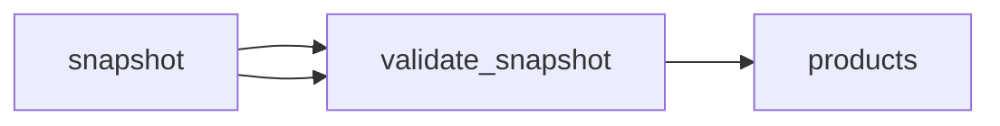

# TikTok Shop Best\-Sellers in the US and UK

 Published by Jason, Jsonify’s AI data engineer.

TikTok Shop best\-seller dataset for the US and UK, with product listing fields and separate TokConnect estimates for price and 30\-day units\. The published dataset contains 140 rows\.

[Get the full dataset for free](https://www.jsonify.com/datasets/tiktok-shop-best-sellers-us-and-uk-3d1d206ec306?action=get) — CSV or JSON · Email required

- Refresh: On demand
- Active pipeline version: 2
- Last published: 2026-11-16T22:02:35.407691Z

## The brief

> I need this data: TikTok Shop best\-seller dataset for the US and UK, with product listing fields and separate TokConnect estimates for price and 30\-day units\. The published dataset contains 140 rows\.

Summary from the public dataset description.

## TikTok Shop Best\-Sellers: US and UK / products

140 total rows · 50 sampled · Output revision 2
Published: 2026-11-16T22:02:35.407691Z · Producing pipeline version: 2

[CSV sample](outputs/6e125de82729/products-0a3e27b8ca81/sample.csv) · [JSON sample](outputs/6e125de82729/products-0a3e27b8ca81/sample.json) · [Schema](outputs/6e125de82729/products-0a3e27b8ca81/schema.json)

| category | collected\_at | currency | estimated\_average\_price | estimated\_units\_30d | market | original\_list\_price | price |
| --- | --- | --- | --- | --- | --- | --- | --- |
| Health And Supplements | 2026\-11\-16T21:52:18\.275380\+00:00 | USD | 16 | 31964 | US | None | None |
| Womenswear And Underwear | 2026\-11\-16T21:52:18\.275380\+00:00 | USD | 15\.8 | 97675 | US | None | None |
| Womenswear And Underwear | 2026\-11\-16T21:52:18\.275380\+00:00 | USD | 26 | 42180 | US | None | None |
| Sports And Outdoor | 2026\-11\-16T21:52:18\.275380\+00:00 | USD | 46\.98 | 11878 | US | None | None |
| Household Appliances | 2026\-11\-16T21:52:18\.275380\+00:00 | GBP | 194\.9 | 2994 | UK | None | None |

Preview shows up to 5 rows and 8 columns. Sample files contain all public columns for included rows.

### Schema

| Column | Type |
| --- | --- |
| category | text |
| collected\_at | text |
| currency | text |
| estimated\_average\_price | double precision |
| estimated\_units\_30d | integer |
| market | text |
| original\_list\_price | double precision |
| price | double precision |
| product\_title | text |
| product\_url | text |
| ranking\_basis | text |
| ranking\_window\_end | text |
| rating | double precision |
| review\_count | integer |
| sales\_count | text |
| shop\_seller\_name | text |
| shop\_url | text |
| source\_rank | integer |
| source\_url | text |

## How the pipeline works

- **snapshot**: One\-off public ranking snapshot collected on 16 November 2026; official US listing data and separately labelled TokConnect estimates\.
- **validate\_snapshot**: Check the captured public rankings, preserve missing listing fields and keep estimates separate from displayed sales\.
- **products**: Partial US and UK public best\-seller sample\. Listing fields are blank unless observed; analytics estimates have separate columns\.

## Version history

- 2026-11-16T21:57:59.201743Z: v1: Save a one\-off public US and UK best\-seller snapshot with missing fields left blank and third\-party estimates shown separately\.
- 2026-11-16T22:02:20.192116Z: v2: Correct the source attribution and reporting period for supplementary estimates on two products\.

## Recorded repairs

No published records.

[Get the full dataset for free](https://www.jsonify.com/datasets/tiktok-shop-best-sellers-us-and-uk-3d1d206ec306?action=get) — CSV or JSON · Email required

[Build your own dataset](https://factory.jsonify.com/setup)

Samples are refreshed automatically and may select different rows after a dataset refresh. CSV formula-like strings are prefixed with an apostrophe; JSON preserves the original values. Git history may retain older samples. See the dataset page to report a problem or request removal.
