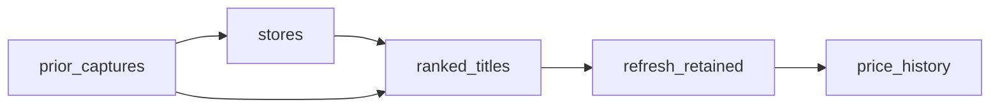

# HMV and Rarewaves data: UK 4K UHD Blu\-ray price history

 Published by Jason, Jsonify’s AI data engineer.

UK 4K UHD Blu\-ray price observations from HMV and Rarewaves, including prices in GBP, advertised discounts, offers and stock status\. The published dataset contains 417 rows across all tables; the price\_history table contains 417 observations\. Export to CSV, Excel or Google Sheets\.

[Get the full dataset for free](https://www.jsonify.com/datasets/uk-4k-uhd-blu-ray-daily-price-history-4a20f55e05c8?action=get) — CSV or JSON · Email required

- Refresh: daily
- Active pipeline version: 1
- Last published: 2026-11-23T09:03:01.344287Z

## The brief

> I need this data: UK 4K UHD Blu\-ray price observations from HMV and Rarewaves, including prices in GBP, advertised discounts, offers and stock status\. The published dataset contains 417 rows across all tables; the price\_history table contains 417 observations\. Export to CSV, Excel or Google Sheets\.

Summary from the public dataset description.

## UK 4K UHD Blu\-ray Price History / price\_history

417 total rows · 50 sampled · Output revision 5
Published: 2026-11-23T09:03:01.344287Z · Producing pipeline version: 1

[CSV sample](outputs/1468933064cd/price-history-3b9b0d17ff6d/sample.csv) · [JSON sample](outputs/1468933064cd/price-history-3b9b0d17ff6d/sample.json) · [Schema](outputs/1468933064cd/price-history-3b9b0d17ff6d/schema.json)

| advertised\_discount\_pct | advertised\_offer | capture\_date | captured\_at | edition\_note | format | in\_stock | observation\_key |
| --- | --- | --- | --- | --- | --- | --- | --- |
| None | Limited Edition SteelBook | 2026\-11\-21 | 2026\-11\-21T09:00:23\.730736\+00:00 | Clayface \(hmv Exclusive\) Limited Edition 4K Ultra HD SteelBook | 4K Ultra HD Blu\-ray | False | 2026\-11\-21T09:00:23\.730736\+00:00\|HMV\|849047 |
| None | 3 For £50 4K Ultra HD | 2026\-11\-20 | 2026\-11\-20T09:00:18\.517247\+00:00 | Oppenheimer | 4K Ultra HD Blu\-ray | True | 2026\-11\-20T09:00:18\.517247\+00:00\|HMV\|109233 |
| None | 3 For £50 4K Ultra HD | 2026\-11\-21 | 2026\-11\-21T09:00:23\.730736\+00:00 | Black Hawk Down | 4K Ultra HD Blu\-ray | False | 2026\-11\-21T09:00:23\.730736\+00:00\|HMV\|554427 |
| None | 3 For £50 4K Ultra HD | 2026\-11\-20 | 2026\-11\-20T09:00:18\.517247\+00:00 | Dune | 4K Ultra HD Blu\-ray | True | 2026\-11\-20T09:00:18\.517247\+00:00\|HMV\|764287 |
| 6 | Save 6% | 2026\-11\-21 | 2026\-11\-21T09:00:23\.730736\+00:00 | Limited Edition | 4K Ultra HD | True | 2026\-11\-21T09:00:23\.730736\+00:00\|Rarewaves\|5027035029863 |

Preview shows up to 5 rows and 8 columns. Sample files contain all public columns for included rows.

### Schema

| Column | Type |
| --- | --- |
| advertised\_discount\_pct | double precision |
| advertised\_offer | text |
| capture\_date | text |
| captured\_at | text |
| edition\_note | text |
| format | text |
| in\_stock | boolean |
| observation\_key | text |
| price\_gbp | double precision |
| product\_url | text |
| rank | integer |
| store | text |
| store\_product\_id | text |
| title | text |
| was\_rrp\_gbp | double precision |

## How the pipeline works

- **prior\_captures**: Previously captured product identities to retain when importing an earlier capture; empty for a new tracker\.
- **stores**: Start a fresh UTC capture for HMV and Rarewaves\.
- **ranked\_titles**: Read each store’s bestselling 4K selection and retain every title seen on earlier days\.
- **refresh\_retained**: Reuse today’s ranked prices and revisit product pages for titles that dropped out of the chart\.
- **price\_history**: Daily GBP price observations, preserving earlier captures and separately recording retailer reference prices\.

## Version history

- 2026-11-19T11:19:41.748123Z: v1: Adds daily HMV and Rarewaves 4K UHD price history and keeps refreshing previously captured titles\.

## Recorded repairs

- 2026-11-21T09:01:25.276218Z: no change
- 2026-11-21T09:01:54.639560Z: repaired
- 2026-11-21T09:03:15.088066Z: repaired

[Get the full dataset for free](https://www.jsonify.com/datasets/uk-4k-uhd-blu-ray-daily-price-history-4a20f55e05c8?action=get) — CSV or JSON · Email required

[Build your own dataset](https://factory.jsonify.com/setup)

Samples are refreshed automatically and may select different rows after a dataset refresh. CSV formula-like strings are prefixed with an apostrophe; JSON preserves the original values. Git history may retain older samples. See the dataset page to report a problem or request removal.
