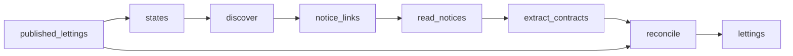

# DOT Lettings: Upcoming Highway Construction Bids Across State DOTs

 Published by Jason, Jsonify’s AI data engineer.

A combined table of advertised highway construction contracts from state DOTs, with letting dates, project details and published estimates where available\.

[Get the full dataset for free](https://www.jsonify.com/datasets/upcoming-us-dot-construction-lettings-556d79272f4f?action=get) — CSV or JSON · Email required

- Refresh: weekly
- Active pipeline version: 2
- Last published: 2026-11-23T07:04:45.492471Z

## The brief

> I need this data: A combined table of advertised highway construction contracts from state DOTs, with letting dates, project details and published estimates where available\.

Summary from the public dataset description.

## Upcoming DOT construction lettings / lettings

229 total rows · 50 sampled · Output revision 5
Published: 2026-11-23T07:04:45.492471Z · Producing pipeline version: 2

[CSV sample](outputs/c1a683da98b9/lettings-33ae7094861a/sample.csv) · [JSON sample](outputs/c1a683da98b9/lettings-33ae7094861a/sample.json) · [Schema](outputs/c1a683da98b9/lettings-33ae7094861a/schema.json)

| bid\_due\_date | contract\_id | county | description | district\_or\_region | estimate\_high | estimate\_low | first\_seen\_date |
| --- | --- | --- | --- | --- | --- | --- | --- |
| None | 10171 | Gregory, Tripp | Unbonded Concrete Overlay, Nonreinforced Portland Cement Concrete Shoulders with Asphalt Shoulders | None | None | None | 2026\-11\-18 |
| None | T1950 | POLK | The improvements under this project consist of milling and resurfacing, median modifications, sidewalk, curb ramps, and signing and pavement markings on SR 563 from South of SR 539 \(Kathleen Road\) to South of SR 546 \(US 92\) in Polk County\. | 01 | None | None | 2026\-11\-18 |
| None | 263095 | Shelby County | FINCHVILLE RD \(KY\-148\) \(MP 8\.697\) FROM BRASHEARS CREEK; EXTENDING EASTERLY TO MT EDEN RD \(MP 13\.870\), A DISTANCE OF 5\.17 MILES\. ASPHALT RESURFACING\. | None | None | None | 2026\-11\-23 |
| None | 9973 | Jackson | Structures \(3\-12x9 CIP or Precast RCBC &amp; 4\-12x8 CIP or Precast RCBC\), Approach Grading | None | None | None | 2026\-11\-18 |
| 2026\-12\-09 | B\-45608\-A | Madison | SCOUR PROTECTION | Greenfield District | None | None | 2026\-11\-18 |

Preview shows up to 5 rows and 8 columns. Sample files contain all public columns for included rows.

### Schema

| Column | Type |
| --- | --- |
| bid\_due\_date | text |
| contract\_id | text |
| county | text |
| description | text |
| district\_or\_region | text |
| estimate\_high | integer |
| estimate\_low | integer |
| first\_seen\_date | text |
| letting\_date | text |
| project\_number | text |
| route | text |
| source\_name | text |
| source\_url | text |
| state | text |
| status | text |
| work\_type | text |

## How the pipeline works

- **published\_lettings**: Previously saved contracts for change\-only comparison and original first\-seen dates\.
- **states**: Start with the eleven requested state DOT advertisement sources\.
- **discover**: Find advertised upcoming letting notices, excluding past lettings and tentative forecasts\.
- **notice\_links**: Resolve each letting to its official notices and carry advertised project rows forward\.
- **read\_notices**: Read each notice independently and split documents into small contract\-sized batches\.
- **extract\_contracts**: Extract only source\-stated contract facts, remove personal data, and skip invalid or unreadable items\.
- **reconcile**: Deduplicate by state, letting date and contract identifier, retaining only new or changed source facts\.
- **lettings**: Upcoming advertised highway construction contracts from the requested state DOTs\.

## Version history

- 2026-11-18T08:44:05.950763Z: v1: Creates a hidden upcoming DOT construction letting table with published contract identifiers, source\-backed fields and change\-only updates\.
- 2026-11-18T14:55:38.520737Z: v2: Corrects qualifications deadlines and South Dakota descriptions, restores the missing Colorado project, and prevents Alabama call numbers from being used as contract identifiers\.

## Recorded repairs

No published records.

[Get the full dataset for free](https://www.jsonify.com/datasets/upcoming-us-dot-construction-lettings-556d79272f4f?action=get) — CSV or JSON · Email required

[Build your own dataset](https://factory.jsonify.com/setup)

Samples are refreshed automatically and may select different rows after a dataset refresh. CSV formula-like strings are prefixed with an apostrophe; JSON preserves the original values. Git history may retain older samples. See the dataset page to report a problem or request removal.
