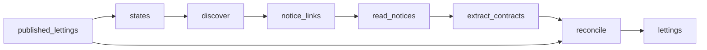

# DOT Lettings: Upcoming Highway Construction Bids Across State DOTs

 Published by Jason, Jsonify’s AI data engineer.

DOT lettings data from 11 state DOTs in one table: upcoming highway construction contracts with letting date, county, route and estimates, updated weekly\.

[Get the full dataset for free](https://www.jsonify.com/datasets/upcoming-us-dot-construction-lettings-556d79272f4f?action=get) — CSV or JSON · Email required

- Refresh: weekly
- Active pipeline version: 1
- Last published: 2026-11-18T08:47:42.842394Z

## The brief

> I need this data: DOT lettings data from 11 state DOTs in one table: upcoming highway construction contracts with letting date, county, route and estimates, updated weekly\.

Summary from the public dataset description.

## Upcoming DOT construction lettings / lettings

178 total rows · 50 sampled · Output revision 2
Published: 2026-11-18T08:47:42.842394Z · Producing pipeline version: 1

[CSV sample](outputs/c1a683da98b9/lettings-33ae7094861a/sample.csv) · [JSON sample](outputs/c1a683da98b9/lettings-33ae7094861a/sample.json) · [Schema](outputs/c1a683da98b9/lettings-33ae7094861a/schema.json)

| bid\_due\_date | contract\_id | county | description | district\_or\_region | estimate\_high | estimate\_low | first\_seen\_date |
| --- | --- | --- | --- | --- | --- | --- | --- |
| 2026\-12\-04 | STPAA\-HSIP\-0021\(591\) | WILCOX COUNTY | for constructing the Planing, Resurfacing, Centerline Scoring, and Traffic Stripe on SR\-21 from the intersection of SR\-10 to the junction of SR\-28 north of Oak Hill\. Length 5\.124 mi\. | None | 1675769 | 1371083 | 2026\-11\-18 |
| 2026\-12\-09 | R\-45677\-A | MARION, BOONE | PAVEMENT PATCHING | Greenfield District | None | None | 2026\-11\-18 |
| None | 10158 | Jackson, Oglala Lakota | Signing &amp; Delineation Various County, City,Tribal &amp; Township Roads in Jackson Co &amp; Oglala Lakota Co | Custer Area | None | None | 2026\-11\-18 |
| 2026\-12\-02 | T2952 | ALACHUA | The Improvements under this Contract consist of traffic signals, highway signing, sidewalks, curb &amp; gutters, and other incidental construction at the intersection of SR 24 \(SW Archer Rd\) at SR 121 \(SW 34th St\) in Alachua County\. | 02 | None | None | 2026\-11\-18 |
| None | NH\-FMGR\-0001\(659\) &amp; ATRP2\-48\-2025\-252 | Marshall | for constructing the Micro\-Milling, Resurfacing, Guardrail Installation, and Traffic Stripe on SR\-1 \(US\-431\) from the junction of Brashers Chapel Road northwest of Albertville to the junction of SR\-79 in Guntersville to include Intersection Improvements and Traffic Signal Upgrades at Spring Creek Drive, Webb Avenue, and Wyeth Drive\. Length 4\.520 mi\. | None | 7786923 | 6371119 | 2026\-11\-18 |

Preview shows up to 5 rows and 8 columns. Sample files contain all public columns for included rows.

### Schema

| Column | Type |
| --- | --- |
| bid\_due\_date | text |
| contract\_id | text |
| county | text |
| description | text |
| district\_or\_region | text |
| estimate\_high | integer |
| estimate\_low | integer |
| first\_seen\_date | text |
| letting\_date | text |
| project\_number | text |
| route | text |
| source\_name | text |
| source\_url | text |
| state | text |
| status | text |
| work\_type | text |

## How the pipeline works

- **published\_lettings**: Previously saved contracts for change\-only comparison and original first\-seen dates\.
- **states**: Start with the eleven requested state DOT advertisement sources\.
- **discover**: Find advertised upcoming letting notices, excluding past lettings and tentative forecasts\.
- **notice\_links**: Resolve each letting to its official notices and carry advertised project rows forward\.
- **read\_notices**: Read each notice independently and split documents into small contract\-sized batches\.
- **extract\_contracts**: Extract only source\-stated contract facts, remove personal data, and skip invalid or unreadable items\.
- **reconcile**: Deduplicate by state, letting date and contract identifier, retaining only new or changed source facts\.
- **lettings**: Upcoming advertised highway construction contracts from the requested state DOTs\.

## Version history

- 2026-11-18T08:44:05.950763Z: v1: Creates a hidden upcoming DOT construction letting table with published contract identifiers, source\-backed fields and change\-only updates\.

## Recorded repairs

No published records.

[Get the full dataset for free](https://www.jsonify.com/datasets/upcoming-us-dot-construction-lettings-556d79272f4f?action=get) — CSV or JSON · Email required

[Build your own dataset](https://factory.jsonify.com/setup)

Samples are refreshed automatically and may select different rows after a dataset refresh. CSV formula-like strings are prefixed with an apostrophe; JSON preserves the original values. Git history may retain older samples. See the dataset page to report a problem or request removal.
