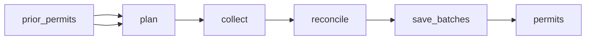

# Drilling Permits: New Oil and Gas Permits in TX, OK and CO

 Published by Jason, Jsonify’s AI data engineer.

A combined table of drilling permits published by the Texas RRC, Oklahoma OCC and Colorado ECMC, with operator, county, depth, well type and approval date\.

[Get the full dataset for free](https://www.jsonify.com/datasets/us-approved-drilling-permits-bbab01ba75f7?action=get) — CSV or JSON · Email required

- Refresh: weekly
- Active pipeline version: 3
- Last published: 2026-11-24T07:05:19.193159Z

## The brief

> I need this data: A combined table of drilling permits published by the Texas RRC, Oklahoma OCC and Colorado ECMC, with operator, county, depth, well type and approval date\.

Summary from the public dataset description.

## US Approved Drilling Permits / permits

1,621 total rows · 50 sampled · Output revision 4
Published: 2026-11-24T07:05:19.193159Z · Producing pipeline version: 3

[CSV sample](outputs/810b7daf8bdd/permits-f9b6938a67e1/sample.csv) · [JSON sample](outputs/810b7daf8bdd/permits-f9b6938a67e1/sample.json) · [Schema](outputs/810b7daf8bdd/permits-f9b6938a67e1/schema.json)

| api\_number | county | field\_name | first\_seen\_date | latitude | longitude | operator\_name | operator\_number |
| --- | --- | --- | --- | --- | --- | --- | --- |
| 12335848 | DeWitt | None | 2026\-11\-22 | "29\.0748667" | "\-97\.5279361" | BURLINGTON RESOURCES O &amp; G CO LP | 109333 |
| 32948635 | Midland | None | 2026\-11\-22 | None | None | DIAMONDBACK E&amp;P LLC | 217012 |
| 41535816 | Scurry | None | 2026\-11\-22 | None | None | KINDER MORGAN PRODUCTION CO LLC | 463316 |
| 20335839 | Harrison | None | 2026\-11\-22 | None | None | RFE OPERATING, LLC | 704776 |
| 10312787 | Rio Blanco | SULPHUR CREEK | 2026\-11\-22 | "39\.863672" | "\-108\.358606" | TEP ROCKY MOUNTAIN LLC | 96850 |

Preview shows up to 5 rows and 8 columns. Sample files contain all public columns for included rows.

### Schema

| Column | Type |
| --- | --- |
| api\_number | text |
| county | text |
| field\_name | text |
| first\_seen\_date | text |
| latitude | text |
| longitude | text |
| operator\_name | text |
| operator\_number | text |
| permit\_approved\_date | text |
| permit\_expiration\_date | text |
| permit\_number | text |
| permit\_type | text |
| source\_name | text |
| source\_url | text |
| state | text |
| status | text |
| target\_formation | text |
| total\_depth\_ft | text |
| well\_type | text |
| wellbore\_profile | text |

## How the pipeline works

- **prior\_permits**: Previously published permits, used to retain first\-seen dates and emit only changes\.
- **plan**: Choose the initial sixty\-day Texas and Colorado downloads, or a fourteen\-day refresh, plus Oklahoma’s seven\-day permit file\.
- **collect**: Read only regulator\-published download files, parsing each state’s records and counting unreadable files or records\.
- **reconcile**: Exclude personal operators and incomplete permits, deduplicate each state and permit number, and keep only new or changed records within the monthly cap\.
- **save\_batches**: Validate and checkpoint batches of at most one hundred public permit records\.
- **permits**: One approved permit per state and published permit identifier, excluding personal operators\.

## Version history

- 2026-11-22T08:58:35.775673Z: v1: Collects approved permits from Texas, Oklahoma and Colorado, excluding personal operators\. Starts with a sixty\-day Texas and Colorado backfill and Oklahoma’s seven\-day download, then saves only new or changed permits\.
- 2026-11-22T09:51:17.696863Z: v2: Converts Texas and Colorado county codes to official Census county names in saved and future permits\. Unmatched codes remain unchanged and are counted\.
- 2026-11-22T10:20:20.074424Z: v3: Refreshes now compare depth and coordinates by numeric value, so formatting differences no longer trigger updates to unchanged permits\.

## Recorded repairs

No published records.

[Get the full dataset for free](https://www.jsonify.com/datasets/us-approved-drilling-permits-bbab01ba75f7?action=get) — CSV or JSON · Email required

[Build your own dataset](https://factory.jsonify.com/setup)

Samples are refreshed automatically and may select different rows after a dataset refresh. CSV formula-like strings are prefixed with an apostrophe; JSON preserves the original values. Git history may retain older samples. See the dataset page to report a problem or request removal.
