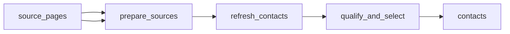

# US Baseball Team Decision\-Maker Contacts: School, Youth and Minor\-League Teams

 Published by Jason, Jsonify’s AI data engineer.

A directory of 1,000 named decision\-maker contacts for selected US school, youth travel and professional minor\-league baseball teams, with publicly listed direct emails and source URLs\.

[Get the full dataset for free](https://www.jsonify.com/datasets/us-baseball-team-decision-maker-contacts-b0b0de74ab33?action=get) — CSV or JSON · Email required

- Refresh: On demand
- Active pipeline version: 1
- Last published: 2026-10-22T14:59:13.945962Z

## The brief

> I need this data: A directory of 1,000 named decision\-maker contacts for selected US school, youth travel and professional minor\-league baseball teams, with publicly listed direct emails and source URLs\.

Summary from the public dataset description.

## US Baseball Team Contacts / contacts

1,000 total rows · 500 sampled · Output revision 1
Published: 2026-10-22T14:59:13.945962Z · Producing pipeline version: 1

[CSV sample](outputs/665218a260df/contacts-aa5af4084f37/sample.csv) · [JSON sample](outputs/665218a260df/contacts-aa5af4084f37/sample.json) · [Schema](outputs/665218a260df/contacts-aa5af4084f37/schema.json)

| First Name | Last Name | Job Title | Team / Organization Name | Direct Email Address | US State | Source URL |
| --- | --- | --- | --- | --- | --- | --- |
| Kate | Little | Athletic Director | Penn Cambria High School | littlekm@pcam\.org | Pennsylvania | [https://www\.piaa\.org/schools/directory/details\.aspx?ID=11267](<https://www.piaa.org/schools/directory/details.aspx?ID=11267>) |
| Adam | Zurick | Athletic Director | Eastern Lebanon County High School | azurick@elcosd\.org | Pennsylvania | [https://www\.piaa\.org/schools/directory/details\.aspx?ID=11109](<https://www.piaa.org/schools/directory/details.aspx?ID=11109>) |
| Jacob | Herbst | Head Coach | Chequamegon | jacob\.herbst17@gmail\.com | Wisconsin | [https://schools\.wiaawi\.org/Directory/School/GetDirectorySchool?orgID=515](<https://schools.wiaawi.org/Directory/School/GetDirectorySchool?orgID=515>) |
| Ty | Stillman | Athletic Director | Firelands High School | tstillman@firelandsschools\.org | Ohio | [https://ohsaa\.finalforms\.com/state\_schools/80650](<https://ohsaa.finalforms.com/state_schools/80650>) |
| Drew | Karpen | Athletic Director | Plum High School | Karpend@pbsd\.net | Pennsylvania | [https://www\.piaa\.org/schools/directory/details\.aspx?ID=11369](<https://www.piaa.org/schools/directory/details.aspx?ID=11369>) |

Preview shows up to 5 rows and 8 columns. Sample files contain all public columns for included rows.

### Schema

| Column | Type |
| --- | --- |
| First Name | text |
| Last Name | text |
| Job Title | text |
| Team / Organization Name | text |
| Direct Email Address | text |
| US State | text |
| Source URL | text |

## How the pipeline works

- **source\_pages**: Selected public school, club and association contact pages, with a bounded replacement reserve\.
- **prepare\_sources**: Select the verified public source panel and keep one request per school or shared directory page\.
- **refresh\_contacts**: Re\-read each public source and retain named baseball decision\-makers whose direct emails appear on that page\.
- **qualify\_and\_select**: Exclude generic mailboxes, deduplicate actual teams, and require exactly the requested number of complete seven\-column records\.
- **contacts**: Named decision\-maker contacts for distinct US baseball teams, with exact public source links\.

## Version history

- 2026-10-22T14:55:32.382567Z: v1: Adds a refreshable collection of 1,000 US baseball team decision\-maker contacts, with public source links and downloadable spreadsheets\.

## Recorded repairs

No published records.

[Get the full dataset for free](https://www.jsonify.com/datasets/us-baseball-team-decision-maker-contacts-b0b0de74ab33?action=get) — CSV or JSON · Email required

[Build your own dataset](https://factory.jsonify.com/setup)

Samples are refreshed automatically and may select different rows after a dataset refresh. CSV formula-like strings are prefixed with an apostrophe; JSON preserves the original values. Git history may retain older samples. See the dataset page to report a problem or request removal.
