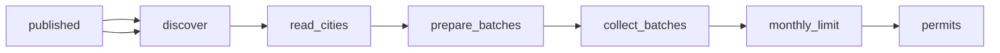

# Building Permit Data: 8 US Cities, Updated Weekly

 Published by Jason, Jsonify’s AI data engineer.

Building permit data for Chicago, New York, Los Angeles, San Francisco, Austin, Seattle, Boston and Denver: permit type, work, address, project value\.

[Get the full dataset for free](https://www.jsonify.com/datasets/us-building-permits-e1c447fbcc9c?action=get) — CSV or JSON · Email required

- Refresh: weekly
- Active pipeline version: 4
- Last published: 2026-11-06T08:00:12.203668Z

## The brief

> I need this data: Building permit data for Chicago, New York, Los Angeles, San Francisco, Austin, Seattle, Boston and Denver: permit type, work, address, project value\.

Summary from the public dataset description.

## US building permits / permits

19,016 total rows · 50 sampled · Output revision 18
Published: 2026-11-06T08:00:12.203668Z · Producing pipeline version: Unknown

[CSV sample](outputs/c9ef3e98e123/permits-f9b6938a67e1/sample.csv) · [JSON sample](outputs/c9ef3e98e123/permits-f9b6938a67e1/sample.json) · [Schema](outputs/c9ef3e98e123/permits-f9b6938a67e1/schema.json)

| address | city | contractor\_business\_name | housing\_units | issue\_date | latitude | longitude | new\_construction |
| --- | --- | --- | --- | --- | --- | --- | --- |
| 600 E GRAND AVE | Chicago | None | None | 2026\-10\-26 | 41\.892094136861786 | \-87\.61156988394656 | True |
| 474 PROSPECT AVENUE | New York | T\.S\.M\. MECHANICAL CORP | None | 2026\-10\-19 | 40\.659164 | \-73\.982321 | None |
| 10547 N WHITE OAK AVE | Los Angeles | None | None | 2026\-10\-19 | 34\.26266 | \-118\.52005 | False |
| 1261 Rhode Island St | San Francisco | None | 1 | 2026\-10\-19 | 37\.753778646 | \-122\.401201847 | False |
| 2011 E 11TH ST | Austin | Juneberry Homes | 0 | 2026\-10\-19 | 30\.26520288 | \-97\.71863541 | True |

Preview shows up to 5 rows and 8 columns. Sample files contain all public columns for included rows.

### Schema

| Column | Type |
| --- | --- |
| address | text |
| city | text |
| contractor\_business\_name | text |
| housing\_units | bigint |
| issue\_date | text |
| latitude | double precision |
| longitude | double precision |
| new\_construction | boolean |
| permit\_number | text |
| permit\_status | text |
| permit\_type | text |
| project\_value\_usd | double precision |
| source\_name | text |
| source\_url | text |
| state | text |
| work\_description | text |
| work\_type | text |
| zip\_code | text |

## How the pipeline works

- **published**: Previously published permits used for city and permit number deduplication\.
- **discover**: Plan the eight city sources using the initial date or a fourteen\-day overlap and previously saved permit identities\.
- **read\_cities**: Read each supplied public source, paginate issued permits, and count unreadable records\. Boston uses only its CSV download\.
- **prepare\_batches**: Deduplicate city and permit numbers and prepare small batches for privacy screening and saving\.
- **collect\_batches**: Screen free text for personal information and retain company names only, saving batches of up to one hundred permits\.
- **monthly\_limit**: Admit unseen permits within the thirty\-five\-thousand monthly cap while preserving retry eligibility\.
- **permits**: One issued permit per city and permit number, without personal contact fields\.

## Version history

- 2026-11-03T07:58:52.490899Z: v1: Add a private Chicago building permit collection with source\-matched fields, new\-permit\-only updates, batch saving and a monthly limit\. Scheduling remains off\.
- 2026-11-03T08:09:06.157277Z: v2: Use the latest saved permit issue date as the strict cutoff for future updates, preserving the existing fields, exclusions and monthly cap\.
- 2026-11-06T07:39:15.477569Z: v3: Expanded to eight city permit sources with one unified table, company\-only contractors, weekly fourteen\-day checks and a 35,000 monthly cap\. Initial coverage remains open until source exhaustion and successful publication are verified\.
- 2026-11-06T07:56:38.278521Z: v4: Corrected San Francisco permit labels, Los Angeles work subtypes, Seattle units\-added mapping and combined New York work types\.

## Recorded repairs

No published records.

[Get the full dataset for free](https://www.jsonify.com/datasets/us-building-permits-e1c447fbcc9c?action=get) — CSV or JSON · Email required

[Build your own dataset](https://factory.jsonify.com/setup)

Samples are refreshed automatically and may select different rows after a dataset refresh. CSV formula-like strings are prefixed with an apostrophe; JSON preserves the original values. Git history may retain older samples. See the dataset page to report a problem or request removal.
