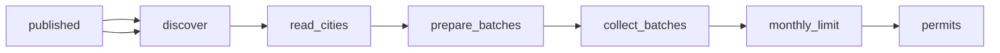

# Building Permit Data: Eight US Cities

 Published by Jason, Jsonify’s AI data engineer.

A combined table of building permits from Chicago, New York City, Los Angeles, San Francisco, Austin, Seattle, Boston and Denver\. Includes permit type, work description, address and project value where published\. Current published table: 24,842 rows\.

[Get the full dataset for free](https://www.jsonify.com/datasets/us-building-permits-e1c447fbcc9c?action=get) — CSV or JSON · Email required

- Refresh: weekly
- Active pipeline version: 5
- Last published: 2026-11-12T06:11:33.173475Z

## The brief

> I need this data: A combined table of building permits from Chicago, New York City, Los Angeles, San Francisco, Austin, Seattle, Boston and Denver\. Includes permit type, work description, address and project value where published\. Current published table: 24,842 rows\.

Summary from the public dataset description.

## US building permits / permits

24,842 total rows · 50 sampled · Output revision 19
Published: 2026-11-12T06:11:33.173475Z · Producing pipeline version: 5

[CSV sample](outputs/c9ef3e98e123/permits-f9b6938a67e1/sample.csv) · [JSON sample](outputs/c9ef3e98e123/permits-f9b6938a67e1/sample.json) · [Schema](outputs/c9ef3e98e123/permits-f9b6938a67e1/schema.json)

| city | state | permit\_number | issue\_date | permit\_type | work\_type | work\_description | address |
| --- | --- | --- | --- | --- | --- | --- | --- |
| Austin | TX | 2026\-137243 BP | 2026\-10\-19 | Building Permit | New | ePlan: Commercial Expedited Review \- \[PULBLIC PROJECT\] New Construction of Austin Convention Center \- Area 1\. | 500 E 3RD ST |
| Austin | TX | 2026\-137244 BP | 2026\-10\-19 | Building Permit | New | ePlan: Commercial Expedited Review \- \[PULBLIC PROJECT\] New Construction of Austin Convention Center \- Area 2\. | 500 E 3RD ST |
| Austin | TX | 2026\-137245 BP | 2026\-10\-19 | Building Permit | New | ePlan: Commercial Expedited Review \- \[PULBLIC PROJECT\] New Construction of Austin Convention Center \- Area 3\. | 500 E 3RD ST |
| Austin | TX | 2026\-137246 BP | 2026\-10\-19 | Building Permit | New | ePlan: Commercial Expedited Review \- \[PULBLIC PROJECT\] New Construction of Austin Convention Center \- Area 4\. | 500 E 3RD ST |
| Chicago | IL | 101084976 | 2026\-10\-28 | PERMIT \- NEW CONSTRUCTION | None | DDS 2019 CBC\. NEW CONSTRUCTION, FULL BUILDING PERMIT FOR A 2 STORY BUILDING WITH A MEZZANINE AND NO BASEMENT AS PER PLANS\. OCCUPANCY GROUPS A\-1, A\-3, B, M, S\-1 AND S\-2\. \(NON\-SEPARATED\)\.TYPE 1\-B CONSTRUCTION\. CAISSONS ONLY PERMIT \#101074704\. FOUNDATION\-SUPERSTRUCTURE PERMIT \#101077786\. CONSULTANT REVIEWER: V3 COMPANIES OF IL | 1904 W ADAMS ST |

Preview shows up to 5 rows and 8 columns. Sample files contain all public columns for included rows.

### Schema

| Column | Type |
| --- | --- |
| city | text |
| state | text |
| permit\_number | text |
| issue\_date | text |
| permit\_type | text |
| work\_type | text |
| work\_description | text |
| address | text |
| zip\_code | text |
| project\_value\_usd | double precision |
| contractor\_business\_name | text |
| permit\_status | text |
| new\_construction | boolean |
| housing\_units | integer |
| latitude | double precision |
| longitude | double precision |
| source\_name | text |
| source\_url | text |

## How the pipeline works

- **published**: Previously published permits used for city and permit number deduplication\.
- **discover**: Plan the eight city sources using the initial date or a fourteen\-day overlap and previously saved permit identities\.
- **read\_cities**: Read each supplied public source, paginate issued permits, and count unreadable records\. Boston uses only its CSV download\.
- **prepare\_batches**: Deduplicate city and permit numbers and prepare small batches for privacy screening and saving\.
- **collect\_batches**: Screen free text for personal information and retain company names only, saving batches of up to one hundred permits\.
- **monthly\_limit**: Admit unseen permits within the fifty\-thousand monthly cap while preserving retry eligibility\.
- **permits**: One issued permit per city and permit number, without personal contact fields\.

## Version history

- 2026-11-03T07:58:52.490899Z: v1: Add a private Chicago building permit collection with source\-matched fields, new\-permit\-only updates, batch saving and a monthly limit\. Scheduling remains off\.
- 2026-11-03T08:09:06.157277Z: v2: Use the latest saved permit issue date as the strict cutoff for future updates, preserving the existing fields, exclusions and monthly cap\.
- 2026-11-06T07:39:15.477569Z: v3: Expanded to eight city permit sources with one unified table, company\-only contractors, weekly fourteen\-day checks and a 35,000 monthly cap\. Initial coverage remains open until source exhaustion and successful publication are verified\.
- 2026-11-06T07:56:38.278521Z: v4: Corrected San Francisco permit labels, Los Angeles work subtypes, Seattle units\-added mapping and combined New York work types\.
- 2026-11-10T13:04:40.523715Z: v5: Raised the monthly new\-permit limit from 35,000 to 50,000\. Existing sources, fields, Thursday schedule and fourteen\-day look\-back are unchanged\.

## Recorded repairs

No published records.

[Get the full dataset for free](https://www.jsonify.com/datasets/us-building-permits-e1c447fbcc9c?action=get) — CSV or JSON · Email required

[Build your own dataset](https://factory.jsonify.com/setup)

Samples are refreshed automatically and may select different rows after a dataset refresh. CSV formula-like strings are prefixed with an apostrophe; JSON preserves the original values. Git history may retain older samples. See the dataset page to report a problem or request removal.
