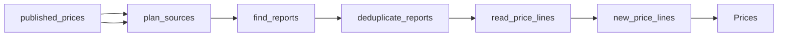

# Cattle Market Reports: US Auction Prices by Sale Barn

 Published by Jason, Jsonify’s AI data engineer.

Cattle market reports from 10 US sale barns in one table: steers, heifers, cows, bulls, bred cows and pairs with head, weights and prices\. Updated weekly\.

[Get the full dataset for free](https://www.jsonify.com/datasets/us-cattle-market-reports-ccce08fab24b?action=get) — CSV or JSON · Email required

- Refresh: weekly
- Active pipeline version: 1
- Last published: 2026-11-27T18:56:02.031590Z

## The brief

> I need this data: Cattle market reports from 10 US sale barns in one table: steers, heifers, cows, bulls, bred cows and pairs with head, weights and prices\. Updated weekly\.

Summary from the public dataset description.

## US cattle auction prices / Prices

6,173 total rows · 50 sampled · Output revision 2
Published: 2026-11-27T18:56:02.031590Z · Producing pipeline version: 1

[CSV sample](outputs/388dd1f4524b/prices-5a6e4f56c0a2/sample.csv) · [JSON sample](outputs/388dd1f4524b/prices-5a6e4f56c0a2/sample.json) · [Schema](outputs/388dd1f4524b/prices-5a6e4f56c0a2/schema.json)

| avg\_price | avg\_weight\_lbs | cattle\_class | description | first\_seen\_date | head\_count | market\_city | market\_name |
| --- | --- | --- | --- | --- | --- | --- | --- |
| 458\.69 | 409 | heifers | HEIFERS \- Medium and Large 1\-2 | 2026\-11\-27 | 36 | Dodge City | Winter Livestock Dodge City |
| 402 | 507 | steers | STEERS \- Medium and Large 1 Unweaned | 2026\-11\-27 | 8 | Dodge City | Winter Livestock Dodge City |
| None | 497 | heifers | BKBWF\-HFCF | 2026\-11\-27 | 15 | Billings | Billings Livestock Commission |
| None | 501 | steers | Blk Str Clf | 2026\-11\-27 | 52 | Torrington | Torrington Livestock Markets |
| 375\.69 | 630 | steers | STEERS \- Medium and Large 1\-2 | 2026\-11\-27 | 84 | Pratt | Winter Livestock Pratt |

Preview shows up to 5 rows and 8 columns. Sample files contain all public columns for included rows.

### Schema

| Column | Type |
| --- | --- |
| avg\_price | double precision |
| avg\_weight\_lbs | double precision |
| cattle\_class | text |
| description | text |
| first\_seen\_date | text |
| head\_count | double precision |
| market\_city | text |
| market\_name | text |
| market\_state | text |
| price\_high | double precision |
| price\_low | double precision |
| price\_unit | text |
| row\_key | text |
| sale\_date | text |
| sale\_receipts | double precision |
| sale\_type | text |
| source\_format | text |
| source\_url | text |
| weight\_high\_lbs | double precision |
| weight\_low\_lbs | double precision |

## How the pipeline works

- **published\_prices**: Read the saved price keys and first\-seen dates before looking for new records\.
- **plan\_sources**: Choose the historical backfill or rolling sale window, and prepare independent archive requests\.
- **find\_reports**: Identify in\-window reports using the venue archives and official historical release indexes\.
- **deduplicate\_reports**: Process each linked report once, in stable date order\.
- **read\_price\_lines**: Read one public report and emit only cattle pricing fields, with skip counts\.
- **new\_price\_lines**: Keep unseen business keys and enforce the monthly ceiling against published data\.
- **Prices**: One deduplicated cattle price line for one dated sale report\.

## Version history

- 2026-11-27T18:55:16.886593Z: v1: Collects and reconciles the dated cattle price lines from the requested sale reports\.

## Recorded repairs

No published records.

[Get the full dataset for free](https://www.jsonify.com/datasets/us-cattle-market-reports-ccce08fab24b?action=get) — CSV or JSON · Email required

[Build your own dataset](https://factory.jsonify.com/setup)

Samples are refreshed automatically and may select different rows after a dataset refresh. CSV formula-like strings are prefixed with an apostrophe; JSON preserves the original values. Git history may retain older samples. See the dataset page to report a problem or request removal.
