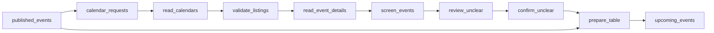

# Trade Show List: US Conference Database, Updated Weekly

 Published by Jason, Jsonify’s AI data engineer.

A list of upcoming US trade shows and conferences from 17 convention centers: event, venue, city, dates and type\. B2B events only, refreshed weekly\.

[Get the full dataset for free](https://www.jsonify.com/datasets/us-convention-center-b2b-events-c9c108704516?action=get) — CSV or JSON · Email required

- Refresh: weekly
- Active pipeline version: 2
- Last published: 2026-11-26T20:16:46.702259Z

## The brief

> I need this data: A list of upcoming US trade shows and conferences from 17 convention centers: event, venue, city, dates and type\. B2B events only, refreshed weekly\.

Summary from the public dataset description.

## Upcoming US convention center events / upcoming\_events

345 total rows · 50 sampled · Output revision 2
Published: 2026-11-26T20:16:46.702259Z · Producing pipeline version: Unknown

[CSV sample](outputs/3b2851726f69/upcoming-events-54b6d8b38960/sample.csv) · [JSON sample](outputs/3b2851726f69/upcoming-events-54b6d8b38960/sample.json) · [Schema](outputs/3b2851726f69/upcoming-events-54b6d8b38960/schema.json)

| city | end\_date | event\_name | event\_type | event\_website | expected\_attendance | first\_seen\_date | industry |
| --- | --- | --- | --- | --- | --- | --- | --- |
| Tacoma | 2026\-12\-03 | Western Winter Sports Representative Association Winter Show | None | [https://wwsra\.com/](<https://wwsra.com/>) | None | 2026\-11\-26 | None |
| Chicago | 2026\-12\-03 | Radiological Society of North America \- RSNA 2026 | None | [https://www\.rsna\.org](<https://www.rsna.org>) | 34308 | 2026\-11\-26 | None |
| Raleigh | 2026\-12\-04 | 30th International Conference on Optical Fiber Sensors | Conference | [https://ofs30\.org/](<https://ofs30.org/>) | None | 2026\-11\-26 | None |
| Tacoma | 2026\-12\-03 | Worldwide Buying Group Winter Show | None | None | None | 2026\-11\-26 | None |
| Boston | 2026\-12\-04 | Materials Research Society Fall Meeting &amp; Exhibit 2026 | None | [http://www\.mrs\.org](<http://www.mrs.org>) | None | 2026\-11\-26 | None |

Preview shows up to 5 rows and 8 columns. Sample files contain all public columns for included rows.

### Schema

| Column | Type |
| --- | --- |
| city | text |
| end\_date | text |
| event\_name | text |
| event\_type | text |
| event\_website | text |
| expected\_attendance | bigint |
| first\_seen\_date | text |
| industry | text |
| last\_seen\_date | text |
| open\_to | text |
| organizer | text |
| source\_name | text |
| source\_url | text |
| start\_date | text |
| state | text |
| venue\_name | text |
| event\_key | text |

## How the pipeline works

- **published\_events**: Previously published convention center events\.
- **calendar\_requests**: Build bounded listing requests for the upcoming twelve months at the approved convention centers\.
- **read\_calendars**: Read official event calendars in independent venue or month batches and count unreadable pages\.
- **validate\_listings**: Keep dated, distinct listings within the next twelve months and tally unreadable records\.
- **read\_event\_details**: Read the venue’s own event detail where it can verify attendance, audience, website, and event purpose\.
- **screen\_events**: Classify small batches as qualifying professional events, excluded events, or events without enough evidence\.
- **review\_unclear**: Separate listings that need a second check from those already classified\.
- **confirm\_unclear**: Recheck ambiguous event formats and recover usable listings where the calendar provides clear professional evidence\.
- **prepare\_table**: Verify incoming events, preserve first\-seen dates, and select new or changed observations only\.
- **upcoming\_events**: Upcoming verified B2B convention center events, one row per venue, event name, and start date\.

## Version history

- 2026-11-26T13:06:25.694428Z: v1: Build the table and retain official event links published alongside the Tacoma listings\.
- 2026-11-26T20:18:51.327687Z: v2: Use a stable technical event key to save only new or changed observations while retaining past events and original first\-seen dates\.

## Recorded repairs

No published records.

[Get the full dataset for free](https://www.jsonify.com/datasets/us-convention-center-b2b-events-c9c108704516?action=get) — CSV or JSON · Email required

[Build your own dataset](https://factory.jsonify.com/setup)

Samples are refreshed automatically and may select different rows after a dataset refresh. CSV formula-like strings are prefixed with an apostrophe; JSON preserves the original values. Git history may retain older samples. See the dataset page to report a problem or request removal.
