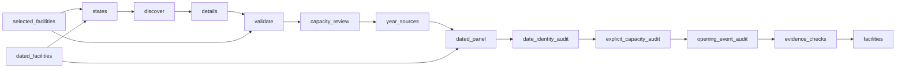

# US Data Centers: Virginia, Texas, Arizona, Georgia and Ohio

 Published by Jason, Jsonify’s AI data engineer.

125 US data center facility and campus listings from Datacenters\.com, with source\-linked locations and directory\-reported capacity and dates where available\.

[Get the full dataset for free](https://www.jsonify.com/datasets/us-data-centers-five-state-sample-dfb1295a7834?action=get) — CSV or JSON · Email required

- Refresh: weekly
- Active pipeline version: 11
- Last published: 2026-11-23T09:20:50.205954Z

## The brief

> I need this data: 125 US data center facility and campus listings from Datacenters\.com, with source\-linked locations and directory\-reported capacity and dates where available\.

Summary from the public dataset description.

## US Data Centers • Five\-State Sample / facilities

125 total rows · 50 sampled · Output revision 8
Published: 2026-11-23T09:20:50.205954Z · Producing pipeline version: 11

[CSV sample](outputs/128b421e373a/facilities-3c5ca5554a2f/sample.csv) · [JSON sample](outputs/128b421e373a/facilities-3c5ca5554a2f/sample.json) · [Schema](outputs/128b421e373a/facilities-3c5ca5554a2f/schema.json)

| capacity\_scope | checked\_at | city | directory\_power\_capacity\_mw | facility\_name | opened\_or\_announced\_year | operator | power\_capacity\_mw |
| --- | --- | --- | --- | --- | --- | --- | --- |
| not shown: no supported total power capacity on the directory page | 2026\-11\-23T08:21:37\.715514\+00:00 | Columbus | None | COL3 Columbus Data Center | None | Cologix | None |
| facility: The CIN5 data center has access to 14\.0 MW of power\. The page does not attribute that figure to the site's build\-to\-suit options\. | 2026\-11\-23T08:21:46\.131873\+00:00 | Lebanon | 14 | CIN5 Cincinnati North Cincinnati Data Center | None | CyrusOne | 14 |
| facility: 24 MW is the available power at the Texas 1 Data Center, not a total for the Data Ranch campus\. | 2026\-11\-23T08:21:55\.921086\+00:00 | Austin | 24 | Texas 1 Data Center | None | Switch Data Centers | 24 |
| campus: The three\-building IAD1 Sterling Data Center Campus has access to 47\.0 MW of power\. | 2026\-11\-23T08:22:30\.141951\+00:00 | Sterling | 47 | IAD1 Sterling Data Center Campus | None | Csquare | 47 |
| planned total: The description presents 120 MW as the planned capacity of the new ASH1 facility, while the summary lists the same figure as available power\. | 2026\-11\-23T08:22:17\.268905\+00:00 | Ashburn | 120 | ASH1 Ashburn Data Center | None | Cologix | 120 |

Preview shows up to 5 rows and 8 columns. Sample files contain all public columns for included rows.

### Schema

| Column | Type |
| --- | --- |
| capacity\_scope | text |
| checked\_at | text |
| city | text |
| directory\_power\_capacity\_mw | double precision |
| facility\_name | text |
| opened\_or\_announced\_year | integer |
| operator | text |
| power\_capacity\_mw | double precision |
| power\_evidence | text |
| source\_url | text |
| state | text |
| status | text |
| status\_evidence | text |
| street\_address | text |
| year\_evidence | text |
| year\_match\_evidence | text |
| year\_research\_note | text |
| year\_source\_url | text |
| year\_type | text |

## How the pipeline works

- **selected\_facilities**: Optional previously validated facility snapshot for evidence updates; unbound runs rediscover the normal five\-state sample\.
- **dated\_facilities**: Optional saved facility snapshot for revalidating date identity without repeating discovery or research\.
- **states**: Choose the five requested states for a balanced public facility sample\.
- **discover**: Read the first directory page in each state and discover distinct street\-addressed business locations for a balanced sample\.
- **details**: Read each facility page for its actual city, stated total MW capacity and explicitly described lifecycle dates and status\.
- **validate**: Check unique source pages and distinct addresses, all five states and the exact requested balanced sample before replacing the saved snapshot\.
- **capacity\_review**: Recheck source capacity scope and contradictions, preserve the stated directory figure, and reject construction\-only opening years\.
- **year\_sources**: Find and verify explicit opening or announcement years on confidently matched public second\-source facility or press pages\.
- **dated\_panel**: Reuse a saved complete panel when only date identity needs rechecking\.
- **date\_identity\_audit**: Require exact address or operator\-specific facility identity before retaining a secondary\-source year\.
- **explicit\_capacity\_audit**: Withhold canonical capacity when the facility description explicitly contradicts its directory total power\.
- **opening\_event\_audit**: Distinguish a dated actual\-opening announcement from the initial announcement of a future project\.
- **evidence\_checks**: Check year/source consistency and retain the full requested five\-state panel for an ordinary refresh\.
- **facilities**: Source\-backed five\-state public data center facility sample, with secondary\-source year evidence and capacity scope notes\.

## Version history

- 2026-11-17T14:38:21.648369Z: v1: Create a balanced public five\-state facility sample with source\-backed capacity and lifecycle fields, ready for weekly refreshes\.
- 2026-11-17T15:23:45.246026Z: v2: Add cited second\-source opening and announcement years and capacity scope notes\. Remove construction\-only opening dates and flag conflicting or implausible power figures\.
- 2026-11-17T15:32:16.785620Z: v3: Fixed capacity comparisons that stopped the update when evidence came from separate passages\. Source statements remain quoted exactly\.
- 2026-11-17T15:55:46.801897Z: v4: Exclude public\-tour and groundbreaking\-only dates from opening or original announcement years\.
- 2026-11-17T15:58:53.460799Z: v5: Preserved date provenance when refreshing saved facilities and excluded publication timestamps from opening\-year evidence\.
- 2026-11-17T16:01:57.374443Z: v6: Made capacity checks require complete scope and conflict evidence before accepting a result\.
- 2026-11-17T16:20:11.364028Z: v7: Corrected cross\-operator facility\-name matches and added a final physical\-identity check for every secondary\-source year\.
- 2026-11-17T16:26:59.811585Z: v8: Withhold usable capacity when explicit facility total\-power statements contradict the directory figure, retaining both figures in the scope note\.
- 2026-11-17T16:33:05.729173Z: v9: Recognize another explicit facility\-total wording so CIN3 capacity is withheld on its 1 versus 1\.7 MW source conflict\.
- 2026-11-23T08:44:47.863925Z: v10: The weekly refresh now retries unreadable answers during opening and announcement date research\. It still requires the same source evidence before saving a date\.
- 2026-11-23T09:13:56.678174Z: v11: Corrected opening\-event classification and added a check for directory capacity exceeding an explicitly stated facility maximum\. Conflicting capacity stays blank while the original directory figure is preserved\.

## Recorded repairs

- 2026-11-23T08:01:27.179153Z: no change
- 2026-11-23T08:02:05.238126Z: repaired
- 2026-11-23T08:42:38.959539Z: no change
- 2026-11-23T08:51:08.286865Z: repaired
- 2026-11-23T08:51:16.805339Z: repaired
- 2026-11-23T09:05:32.833537Z: repaired
- 2026-11-23T09:08:04.243607Z: no change
- 2026-11-23T09:20:34.486955Z: repaired
- 2026-11-23T09:21:26.334018Z: repaired

[Get the full dataset for free](https://www.jsonify.com/datasets/us-data-centers-five-state-sample-dfb1295a7834?action=get) — CSV or JSON · Email required

[Build your own dataset](https://factory.jsonify.com/setup)

Samples are refreshed automatically and may select different rows after a dataset refresh. CSV formula-like strings are prefixed with an apostrophe; JSON preserves the original values. Git history may retain older samples. See the dataset page to report a problem or request removal.
