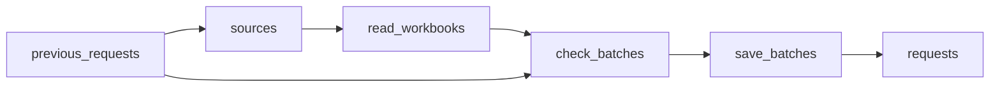

# Interconnection Queue Data: CAISO, NYISO and BPA, Weekly

 Published by Jason, Jsonify’s AI data engineer.

Generator interconnection queue data from CAISO, NYISO and BPA in one table: project, fuel, MW, status, location and in\-service dates, updated weekly\.

[Get the full dataset for free](https://www.jsonify.com/datasets/us-generator-interconnection-queues-68fb9ee25003?action=get) — CSV or JSON · Email required

- Refresh: weekly
- Active pipeline version: 2
- Last published: 2026-11-14T08:35:34.806797Z

## The brief

> I need this data: Generator interconnection queue data from CAISO, NYISO and BPA in one table: project, fuel, MW, status, location and in\-service dates, updated weekly\.

Summary from the public dataset description.

## US generator interconnection queues / requests

3,520 total rows · 50 sampled · Output revision 2
Published: 2026-11-14T08:35:34.806797Z · Producing pipeline version: 2

[CSV sample](outputs/1602d1c4c5ce/requests-ec72420df5df/sample.csv) · [JSON sample](outputs/1602d1c4c5ce/requests-ec72420df5df/sample.json) · [Schema](outputs/1602d1c4c5ce/requests-ec72420df5df/schema.json)

| capacity\_mw | county | first\_seen\_date | fuel\_type | interconnection\_customer | operator | point\_of\_interconnection | project\_name |
| --- | --- | --- | --- | --- | --- | --- | --- |
| 20 | MERCED | 2026\-11\-14 | Solar | None | CAISO | Oro Loma   115kV | PDD WHR SOLAR FARM I |
| 70 | HUMBOLDT | 2026\-11\-14 | Wind Turbine | None | CAISO | Rio Del Junction \- Bridgeville | BEAR RIVER WIND FARM Q=117 |
| 100 | LOS ANGELES | 2026\-11\-14 | Battery | None | CAISO | Laguna Bell Substation 230 kV | RANGER |
| 20 | FRESNO | 2026\-11\-14 | Flywheel | None | CAISO | New Kearny Substation 70kV bus | ENERGY NUEVO STORAGE FARM \(FKA NEW KEARNY ENERGY PARK\) |
| 200 | Gilliam | 2026\-11\-14 | Wind Turbine | Avangrid Power, LLC | BPA | Jones Canyon substation on McNary Santiam line | Pebble Springs Wind Project |

Preview shows up to 5 rows and 8 columns. Sample files contain all public columns for included rows.

### Schema

| Column | Type |
| --- | --- |
| capacity\_mw | double precision |
| county | text |
| first\_seen\_date | text |
| fuel\_type | text |
| interconnection\_customer | text |
| operator | text |
| point\_of\_interconnection | text |
| project\_name | text |
| proposed\_in\_service\_date | text |
| queue\_date | text |
| queue\_position | text |
| request\_date | text |
| source\_name | text |
| source\_updated\_date | text |
| source\_url | text |
| state | text |
| status | text |
| study\_process | text |
| transmission\_owner | text |
| winter\_mw | double precision |
| withdrawn\_date | text |

## How the pipeline works

- **previous\_requests**: Previously saved requests, matched by operator and queue position for updates and preserved first\-seen dates\.
- **sources**: Select the three official operator workbooks, with NYISO resolved from its current interconnections page\.
- **read\_workbooks**: Read published Excel sheets, exclude load requests, and checkpoint normalized requests in batches of 100\.
- **check\_batches**: Validate unique operator and queue keys and reserve the monthly allowance before saving small batches\.
- **save\_batches**: Stream each merged batch of at most 100 requests into the same combined table\.
- **requests**: One request per operator and queue position from the published operator workbooks\.

## Version history

- 2026-11-14T08:17:05.025938Z: v1: Created the hidden initial generator queue snapshot with source blanks retained and load requests excluded\.
- 2026-11-14T08:34:05.583698Z: v2: Corrected NYISO proposed months and last\-updated dates, switched CAISO to current online dates, and added keyed updates that preserve first\-seen dates\.

## Recorded repairs

No published records.

[Get the full dataset for free](https://www.jsonify.com/datasets/us-generator-interconnection-queues-68fb9ee25003?action=get) — CSV or JSON · Email required

[Build your own dataset](https://factory.jsonify.com/setup)

Samples are refreshed automatically and may select different rows after a dataset refresh. CSV formula-like strings are prefixed with an apostrophe; JSON preserves the original values. Git history may retain older samples. See the dataset page to report a problem or request removal.
