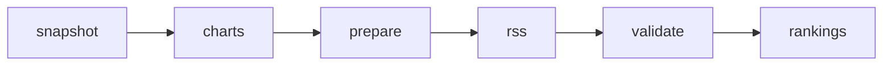

# Podcast Data: US Podcast Database \(Apple, Spotify, YouTube\)

 Published by Jason, Jsonify’s AI data engineer.

Podcast data for the top US shows on Apple Podcasts, Spotify and YouTube: rank, publisher, category, latest episode date and episode count, weekly\.

[Get the full dataset for free](https://www.jsonify.com/datasets/us-podcast-chart-rankings-cb21e3d37859?action=get) — CSV or JSON · Email required

- Refresh: weekly
- Active pipeline version: 1
- Last published: 2026-11-26T12:08:23.960052Z

## The brief

> I need this data: Podcast data for the top US shows on Apple Podcasts, Spotify and YouTube: rank, publisher, category, latest episode date and episode count, weekly\.

Summary from the public dataset description.

## US Podcast Chart Ranking History / rankings

400 total rows · 50 sampled · Output revision 1
Published: 2026-11-26T12:08:23.960052Z · Producing pipeline version: 1

[CSV sample](outputs/38759da90c69/rankings-2b6d9737bd5e/sample.csv) · [JSON sample](outputs/38759da90c69/rankings-2b6d9737bd5e/sample.json) · [Schema](outputs/38759da90c69/rankings-2b6d9737bd5e/schema.json)

| chart\_name | episode\_count | first\_seen\_date | latest\_episode\_date | platform | primary\_category | publisher | rank |
| --- | --- | --- | --- | --- | --- | --- | --- |
| Weekly Top Podcast Shows \(US\) | None | 2026\-11\-26 | None | YouTube | True Crime | None | 35 |
| Top Podcasts \(US\) | 600 | 2026\-11\-26 | 2026\-11\-25 | Spotify | None | The Wall Street Journal | 102 |
| Top Podcasts \(US\) | 501 | 2026\-11\-26 | 2026\-11\-23 | Spotify | None | None | 155 |
| Top Shows \(US\) | 93 | 2026\-11\-26 | 2026\-11\-24 | Apple Podcasts | Comedy | The Ringer | 10 |
| Weekly Top Podcast Shows \(US\) | None | 2026\-11\-26 | None | YouTube | Comedy | None | 53 |

Preview shows up to 5 rows and 8 columns. Sample files contain all public columns for included rows.

### Schema

| Column | Type |
| --- | --- |
| chart\_name | text |
| episode\_count | integer |
| first\_seen\_date | text |
| latest\_episode\_date | text |
| platform | text |
| primary\_category | text |
| publisher | text |
| rank | integer |
| rss\_feed\_url | text |
| show\_id\_on\_platform | text |
| show\_name | text |
| show\_url | text |
| snapshot\_date | text |
| source\_name | text |
| source\_url | text |

## How the pipeline works

- **snapshot**: Set the UTC snapshot date and reserve at most 400 rows against the monthly 50,000\-row ceiling\.
- **charts**: Read the Apple US top 100, Spotify US top 200 and YouTube US weekly top 100\. Block YouTube API paths and read the public chart page\.
- **prepare**: Count unreadable and duplicate chart items, keep required source identities, and remove personal publisher names\.
- **rss**: Find identity\-confirmed Apple show pages, read their public RSS links, and save only latest episode date and the count of episodes present in the feed\. Unreadable enrichment stays empty and is counted\.
- **validate**: Verify unique snapshot keys and required fields, count RSS successes and skipped enrichment, and emit the exact requested table\.
- **rankings**: US podcast platform chart positions by UTC observation date, retaining historical snapshots\.

## Version history

- 2026-11-26T11:56:53.103400Z: v1: Adds US podcast ranking history across Apple, Spotify and YouTube with optional public RSS details and duplicate\-safe snapshots\.

## Recorded repairs

No published records.

[Get the full dataset for free](https://www.jsonify.com/datasets/us-podcast-chart-rankings-cb21e3d37859?action=get) — CSV or JSON · Email required

[Build your own dataset](https://factory.jsonify.com/setup)

Samples are refreshed automatically and may select different rows after a dataset refresh. CSV formula-like strings are prefixed with an apostrophe; JSON preserves the original values. Git history may retain older samples. See the dataset page to report a problem or request removal.
