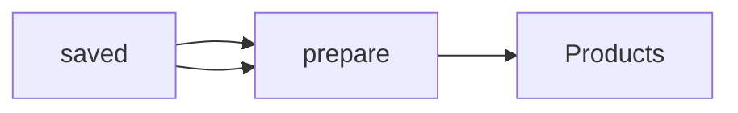

# US Print\-on\-Demand Market Sample

 Published by Jason, Jsonify’s AI data engineer.

US print\-on\-demand market sample with 215 product records from Amazon and Etsy, including prices, review signals, and search positions\.

[Get the full dataset for free](https://www.jsonify.com/datasets/us-print-on-demand-market-sample-da51dc949369?action=get) — CSV or JSON · Email required

- Refresh: On demand
- Active pipeline version: 1
- Last published: 2026-11-16T10:34:18.373859Z

## The brief

> I need this data: US print\-on\-demand market sample with 215 product records from Amazon and Etsy, including prices, review signals, and search positions\.

Summary from the public dataset description.

## US print\-on\-demand market sample / Products

215 total rows · 50 sampled · Output revision 1
Published: 2026-11-16T10:34:18.373859Z · Producing pipeline version: 1

[CSV sample](outputs/9546f30b7ec7/products-4edc8bfafc6b/sample.csv) · [JSON sample](outputs/9546f30b7ec7/products-4edc8bfafc6b/sample.json) · [Schema](outputs/9546f30b7ec7/products-4edc8bfafc6b/schema.json)

| bestseller\_badge\_flags | collected\_at | marketplace | niche\_keyword | pod\_verification | price\_notes | price\_usd | product\_type |
| --- | --- | --- | --- | --- | --- | --- | --- |
| Star Seller | 2026\-11\-08T09:18:08\.972154\+00:00 | Etsy | teacher gift | physical printed\-product candidate; fulfilment model not verified | Displayed search offer or starting variant price; excludes shipping and tax | 21\.6 | hoodie |
| None | 2026\-11\-08T09:18:18\.672124\+00:00 | Amazon Merch on Demand | nurse | Amazon Merch on Demand label on exact product page | Displayed search offer or starting variant price; excludes shipping and tax | 14\.99 | t\-shirt |
| None | 2026\-11\-08T09:25:38\.882848\+00:00 | Amazon Merch on Demand | christmas | Amazon Merch on Demand label on exact product page | Displayed search offer or starting variant price; excludes shipping and tax | 16\.99 | t\-shirt |
| Star Seller; Sponsored | 2026\-11\-08T09:19:01\.372992\+00:00 | Etsy | gardening | physical printed\-product candidate; fulfilment model not verified | Displayed search offer or starting variant price; excludes shipping and tax | 17\.5 | mug |
| None | 2026\-11\-08T09:25:38\.882848\+00:00 | Amazon Merch on Demand | christmas | Amazon Merch on Demand label on exact product page | Displayed search offer or starting variant price; excludes shipping and tax | 16\.99 | t\-shirt |

Preview shows up to 5 rows and 8 columns. Sample files contain all public columns for included rows.

### Schema

| Column | Type |
| --- | --- |
| bestseller\_badge\_flags | text |
| collected\_at | text |
| marketplace | text |
| niche\_keyword | text |
| pod\_verification | text |
| price\_notes | text |
| price\_usd | double precision |
| product\_type | text |
| rank\_notes | text |
| rating | double precision |
| review\_count | integer |
| review\_count\_approximate | boolean |
| review\_count\_display | text |
| review\_scope | text |
| search\_rank\_position | integer |
| search\_url | text |
| shop\_brand | text |
| source\_id | text |
| title | text |
| url | text |

## How the pipeline works

- **saved**: Read the existing saved snapshot without contacting sources\.
- **prepare**: Preserve the saved fields, correct documented QA issues where applicable, and sort for public reading\.
- **Products**: Saved sample records with original observation dates\.

## Version history

- 2026-11-16T10:34:06.060561Z: v1: Publish the existing saved sample with a neutral title and overview\.

## Recorded repairs

No published records.

[Get the full dataset for free](https://www.jsonify.com/datasets/us-print-on-demand-market-sample-da51dc949369?action=get) — CSV or JSON · Email required

[Build your own dataset](https://factory.jsonify.com/setup)

Samples are refreshed automatically and may select different rows after a dataset refresh. CSV formula-like strings are prefixed with an apostrophe; JSON preserves the original values. Git history may retain older samples. See the dataset page to report a problem or request removal.
