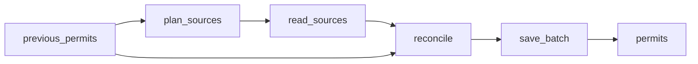

# Mining Permits: State Mining Permit Data for NC, VA and PA

 Published by Jason, Jsonify’s AI data engineer.

Mining permits from North Carolina, Virginia and Pennsylvania in one table: permittee, commodity, county, acres, status and dates, refreshed weekly\.

[Get the full dataset for free](https://www.jsonify.com/datasets/us-state-mining-permits-12c2d09e84a4?action=get) — CSV or JSON · Email required

- Refresh: weekly
- Active pipeline version: 4
- Last published: 2026-11-22T09:07:57.808197Z

## The brief

> I need this data: Mining permits from North Carolina, Virginia and Pennsylvania in one table: permittee, commodity, county, acres, status and dates, refreshed weekly\.

Summary from the public dataset description.

## US State Mining Permits / permits

1,001 total rows · 50 sampled · Output revision 4
Published: 2026-11-22T09:07:57.808197Z · Producing pipeline version: 3

[CSV sample](outputs/29825fb7d6a5/permits-f9b6938a67e1/sample.csv) · [JSON sample](outputs/29825fb7d6a5/permits-f9b6938a67e1/sample.json) · [Schema](outputs/29825fb7d6a5/permits-f9b6938a67e1/schema.json)

| affected\_acres | commodity | county | expiration\_date | first\_seen\_date | latest\_action | latest\_action\_date | latest\_revision\_date |
| --- | --- | --- | --- | --- | --- | --- | --- |
| 150 | TRAPROCK | FAIRFAX | None | 2026\-11\-22 | None | None | None |
| None | Mica | Cleveland | None | 2026\-11\-22 | None | None | 2025\-05\-16 |
| None | Sand and Gravel | Robeson | None | 2026\-11\-22 | None | None | 2024\-12\-20 |
| 3 | SAND; SAND &amp; CLAY; SAND &amp; GRAVEL | GRAYSON | None | 2026\-11\-22 | None | None | None |
| None | Sand and Gravel | Onslow | None | 2026\-11\-22 | None | None | 2017\-12\-01 |

Preview shows up to 5 rows and 8 columns. Sample files contain all public columns for included rows.

### Schema

| Column | Type |
| --- | --- |
| affected\_acres | text |
| commodity | text |
| county | text |
| expiration\_date | text |
| first\_seen\_date | text |
| latest\_action | text |
| latest\_action\_date | text |
| latest\_revision\_date | text |
| latitude | text |
| longitude | text |
| mine\_type | text |
| original\_issue\_date | text |
| permit\_key | text |
| permit\_number | text |
| permit\_status | text |
| permitted\_acres | text |
| permittee\_name | text |
| source\_name | text |
| source\_url | text |
| state | text |

## How the pipeline works

- **previous\_permits**: The last saved permits, used to preserve first\-seen dates and write only changes\.
- **plan\_sources**: Queue the three official state permit sources independently\.
- **read\_sources**: Read the North Carolina map and decisions, newest Virginia annual sheet, and Pennsylvania permit layer with the official county lookup\.
- **reconcile**: Count exclusions, collapse records by state and permit number, and preserve the first\-seen date when a record changes\.
- **save\_batch**: Checkpoint up to 50 checked permit rows at a time for the shared table\.
- **permits**: sink

## Version history

- 2026-11-22T08:22:16.923301Z: v1: Builds the three\-state permit table, including matched North Carolina decisions and Pennsylvania counties\.
- 2026-11-22T08:44:17.821981Z: v2: Corrects North Carolina no\-expiry dates and fills newly affected acreage\. Fixes Virginia date centuries and deduplicates multiline commodities\.
- 2026-11-22T08:52:19.835123Z: v3: Leaves North Carolina affected acreage blank, since newly affected acreage is a different measure\. Keeps the corrected dates and Virginia commodity lists\.
- 2026-11-22T09:20:20.462404Z: v4: Checks the full previous permit table to avoid rewriting unchanged records on weekly refreshes\. Keeps the existing permit key and monthly cap\.

## Recorded repairs

No published records.

[Get the full dataset for free](https://www.jsonify.com/datasets/us-state-mining-permits-12c2d09e84a4?action=get) — CSV or JSON · Email required

[Build your own dataset](https://factory.jsonify.com/setup)

Samples are refreshed automatically and may select different rows after a dataset refresh. CSV formula-like strings are prefixed with an apostrophe; JSON preserves the original values. Git history may retain older samples. See the dataset page to report a problem or request removal.
