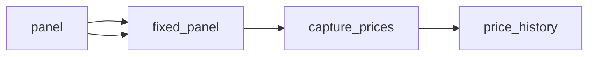

# Walmart grocery and household staples price dataset

 Published by Jason, Jsonify’s AI data engineer.

Walmart\.com product\-page price history for grocery and household staples, including current price, unit price, displayed comparison price, deal flag, stock status and seller\. Export to CSV, Excel or Google Sheets\.

[Get the full dataset for free](https://www.jsonify.com/datasets/walmart-us-daily-staples-prices-ba6711b7e8e1?action=get) — CSV or JSON · Email required

- Refresh: daily
- Active pipeline version: 1
- Last published: 2026-11-27T09:03:06.885726Z

## The brief

> I need this data: Walmart\.com product\-page price history for grocery and household staples, including current price, unit price, displayed comparison price, deal flag, stock status and seller\. Export to CSV, Excel or Google Sheets\.

Summary from the public dataset description.

## Walmart US staples price history / price\_history

120 total rows · 50 sampled · Output revision 3
Published: 2026-11-27T09:03:06.885726Z · Producing pipeline version: 1

[CSV sample](outputs/4a94d97a0877/price-history-3b9b0d17ff6d/sample.csv) · [JSON sample](outputs/4a94d97a0877/price-history-3b9b0d17ff6d/sample.json) · [Schema](outputs/4a94d97a0877/price-history-3b9b0d17ff6d/schema.json)

| brand | capture\_date | capture\_time | currency | current\_price | deal\_flag | fixed\_zip | fulfillment\_context |
| --- | --- | --- | --- | --- | --- | --- | --- |
| Great Value | 2026\-11\-26 | 2026\-11\-26T08:19:43\.079564Z | USD | 0\.92 | none shown | 95829 | \["Pickup, tomorrow at Sacramento Supercenter", "Delivery from store, tomorrow to Sacramento, 95829"\] |
| Quaker | 2026\-11\-26 | 2026\-11\-26T09:02:32\.523921Z | USD | 5\.5 | none shown | 95829 | \["Pickup, tomorrow at Sacramento Gerber Rd Supercenter", "Delivery from store, tomorrow to Sacramento, 95829"\] |
| Great Value | 2026\-11\-26 | 2026\-11\-26T09:01:45\.497857Z | USD | 1\.52 | none shown | 95829 | \["Pickup not available at Sacramento Gerber Rd Supercenter"\] |
| Cheerios | 2026\-11\-27 | 2026\-11\-27T09:02:05\.057023Z | USD | 4\.97 | none shown | 95829 | \["Pickup, today at Sacramento Supercenter", "Delivery from store, today to Sacramento, 95829", "Shipping, arrives by tomorrow to Sacramento, 95829"\] |
| Unbranded | 2026\-11\-26 | 2026\-11\-26T08:19:02\.289298Z | USD | 0\.2 | none shown | 95829 | \["Pickup, tomorrow at Sacramento Supercenter", "Delivery from store, tomorrow to Sacramento, 95829"\] |

Preview shows up to 5 rows and 8 columns. Sample files contain all public columns for included rows.

### Schema

| Column | Type |
| --- | --- |
| brand | text |
| capture\_date | text |
| capture\_time | text |
| currency | text |
| current\_price | double precision |
| deal\_flag | text |
| fixed\_zip | text |
| fulfillment\_context | jsonb |
| in\_stock | boolean |
| observation\_id | text |
| observed\_zip | text |
| price\_context | text |
| price\_display | text |
| price\_qualifier | text |
| product\_name | text |
| sales\_unit | text |
| seller | text |
| size | text |
| sold\_by\_walmart | boolean |
| unit\_price | text |
| url | text |
| walmart\_item\_id | text |
| was\_price | double precision |

## How the pipeline works

- **panel**: Fixed Walmart US staple product pages\. Keep item identifiers unchanged to preserve the comparison panel\.
- **fixed\_panel**: Load the same forty staple product pages for each capture\.
- **capture\_prices**: Read each public Walmart page and verify its selected product, price, seller and stock before keeping the observation\.
- **price\_history**: Timestamped public Walmart staple offers retained across successful captures\.

## Version history

- 2026-11-26T08:18:32.388829Z: v1: Created a forty\-item Walmart staple price history with fixed Sacramento pricing context and verified public\-page collection\.

## Recorded repairs

No published records.

[Get the full dataset for free](https://www.jsonify.com/datasets/walmart-us-daily-staples-prices-ba6711b7e8e1?action=get) — CSV or JSON · Email required

[Build your own dataset](https://factory.jsonify.com/setup)

Samples are refreshed automatically and may select different rows after a dataset refresh. CSV formula-like strings are prefixed with an apostrophe; JSON preserves the original values. Git history may retain older samples. See the dataset page to report a problem or request removal.
