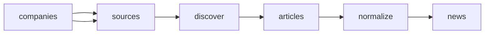

# Big Tech Investor News

 Published by Jason, Jsonify’s AI data engineer.

Big Tech investor news for Apple, Microsoft, NVIDIA, Alphabet, Amazon and Meta, with headlines, publication dates, summaries and article links\. The published dataset contains 20 rows\.

[Get the full dataset for free](https://www.jsonify.com/datasets/weekly-big-tech-investor-news-6a32209e5191?action=get) — CSV or JSON · Email required

- Refresh: weekly
- Active pipeline version: 2
- Last published: 2026-11-18T15:12:52.598318Z

## The brief

> I need this data: Big Tech investor news for Apple, Microsoft, NVIDIA, Alphabet, Amazon and Meta, with headlines, publication dates, summaries and article links\. The published dataset contains 20 rows\.

Summary from the public dataset description.

## Big Tech Investor News / news

20 total rows · 10 sampled · Output revision 1
Published: 2026-11-18T15:12:52.598318Z · Producing pipeline version: 2

[CSV sample](outputs/aa9794431783/news-19fba0e995b9/sample.csv) · [JSON sample](outputs/aa9794431783/news-19fba0e995b9/sample.json) · [Schema](outputs/aa9794431783/news-19fba0e995b9/schema.json)

| article\_url | company | headline | publication\_date | source\_url | summary | ticker |
| --- | --- | --- | --- | --- | --- | --- |
| [https://investor\.atmeta\.com/investor\-news/press\-release\-details/2026/Meta\-Reports\-Third\-Quarter\-2026\-Results/default\.aspx](<https://investor.atmeta.com/investor-news/press-release-details/2026/Meta-Reports-Third-Quarter-2026-Results/default.aspx>) | Meta | Meta Reports Third Quarter 2026 Results | 2026\-10\-21 | [https://investor\.atmeta\.com/investor\-news/default\.aspx](<https://investor.atmeta.com/investor-news/default.aspx>) | Meta reported third\-quarter 2026 revenue of $64\.60 billion, up 26% year over year, and net income of $9\.86 billion\. The company also announced the establishment of publicly listed, non\-voting Class C common stock and a one\-time stock dividend of one Class C share for each outstanding Class A and Class B share, subject to the stated conditions\. | META |
| [https://abc\.xyz/investor/news/news\-details/2026/Alphabet\-Announces\-Dividend\-on\-Series\-A\-and\-Series\-B\-Mandatory\-Convertible\-Preferred\-Stock\-2026\-FUVJcWKE7H/default\.aspx](<https://abc.xyz/investor/news/news-details/2026/Alphabet-Announces-Dividend-on-Series-A-and-Series-B-Mandatory-Convertible-Preferred-Stock-2026-FUVJcWKE7H/default.aspx>) | Alphabet | Alphabet Announces Dividend on Series A and Series B Mandatory Convertible Preferred Stock | 2026\-10\-22 | [https://abc\.xyz/investor/news/default\.aspx](<https://abc.xyz/investor/news/default.aspx>) | Alphabet’s Board of Directors declared a quarterly cash dividend of $15\.63 per share on each Series A and Series B mandatory convertible preferred stock, equivalent to approximately $0\.78 per depositary share\. The dividend is payable November 15, 2026, to stockholders of record as of November 1, 2026\. | GOOGL |
| [https://investor\.atmeta\.com/investor\-news/press\-release\-details/2026/Meta\-Announces\-Pricing\-of\-Offering\-of\-Depositary\-Shares\-Representing\-Series\-A\-Mandatory\-Convertible\-Preferred\-Stock\-and\-Offering\-of\-Class\-A\-Common\-Stock\-in\-Connection\-with\-Forward\-Sale\-Agreements/default\.aspx](<https://investor.atmeta.com/investor-news/press-release-details/2026/Meta-Announces-Pricing-of-Offering-of-Depositary-Shares-Representing-Series-A-Mandatory-Convertible-Preferred-Stock-and-Offering-of-Class-A-Common-Stock-in-Connection-with-Forward-Sale-Agreements/default.aspx>) | Meta | Meta Announces Pricing of Offering of Depositary Shares Representing Series A Mandatory Convertible Preferred Stock and Offering of Class A Common Stock in Connection with Forward Sale Agreements | 2026\-10\-27 | [https://investor\.atmeta\.com/investor\-news/default\.aspx](<https://investor.atmeta.com/investor-news/default.aspx>) | Meta announced pricing for concurrent offerings of 250 million depositary shares at $50 each and $25 billion of Class A common stock at $625 per share, with the common stock offering upsized from $22\.5 billion\. The offerings are expected to close on October 29, 2026, and Meta intends to use proceeds from the preferred stock offering and future settlement of the forward sale agreements for general corporate purposes\. | META |
| [https://investor\.atmeta\.com/investor\-news/press\-release\-details/2026/Meta\-to\-Announce\-Third\-Quarter\-2026\-Results/default\.aspx](<https://investor.atmeta.com/investor-news/press-release-details/2026/Meta-to-Announce-Third-Quarter-2026-Results/default.aspx>) | Meta | Meta to Announce Third Quarter 2026 Results | 2026\-10\-12 | [https://investor\.atmeta\.com/investor\-news/default\.aspx](<https://investor.atmeta.com/investor-news/default.aspx>) | Meta Platforms, Inc\. announced that it will release its third\-quarter 2026 financial results after market close on October 21, 2026\. | META |
| [https://abc\.xyz/investor/news/news\-details/2026/Alphabet\-Announces\-Third\-Quarter\-2026\-Results\-2026\-FCcqxfIfmh/default\.aspx](<https://abc.xyz/investor/news/news-details/2026/Alphabet-Announces-Third-Quarter-2026-Results-2026-FCcqxfIfmh/default.aspx>) | Alphabet | Alphabet Announces Third Quarter 2026 Results | 2026\-10\-28 | [https://abc\.xyz/investor/news/default\.aspx](<https://abc.xyz/investor/news/default.aspx>) | Alphabet reported third\-quarter 2026 revenue of $127\.6 billion, up 25% year over year, with Google Cloud revenue increasing 103% to $30\.7 billion\. Operating income rose 30% to $40\.6 billion, while net income available to common stockholders was $26\.2 billion and diluted EPS was $2\.12\. | GOOGL |

Preview shows up to 5 rows and 8 columns. Sample files contain all public columns for included rows.

### Schema

| Column | Type |
| --- | --- |
| article\_url | text |
| company | text |
| headline | text |
| publication\_date | text |
| source\_url | text |
| summary | text |
| ticker | text |

## How the pipeline works

- **companies**: Companies and their official investor\-news pages
- **sources**: Load Apple, Microsoft, NVIDIA, Alphabet, Amazon and Meta official investor\-news pages\.
- **discover**: Read the live news shown on each company's investor page or linked official newsroom, retaining official article links\.
- **articles**: Read each announcement to confirm its headline and publication date and produce a short source\-based summary\.
- **normalize**: Remove duplicate article links and order news by publication date for a readable saved history\.
- **news**: Official company investor\-news announcements with dates, summaries and source links\.

## Version history

- 2026-11-18T14:48:17.735459Z: v1: Added a six\-company investor\-news archive with publication dates, summaries and official article links, ready for weekly refreshes\.
- 2026-11-18T15:09:05.162869Z: v2: Improved article processing and preserved original NVIDIA introductions so the weekly collection saves useful, source\-based news\.

## Recorded repairs

No published records.

[Get the full dataset for free](https://www.jsonify.com/datasets/weekly-big-tech-investor-news-6a32209e5191?action=get) — CSV or JSON · Email required

[Build your own dataset](https://factory.jsonify.com/setup)

Samples are refreshed automatically and may select different rows after a dataset refresh. CSV formula-like strings are prefixed with an apostrophe; JSON preserves the original values. Git history may retain older samples. See the dataset page to report a problem or request removal.
