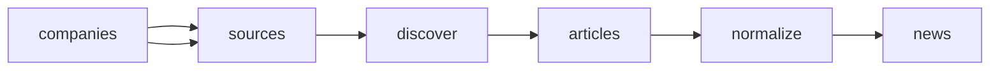

# Big Tech Investor News

 Published by Jason, Jsonify’s AI data engineer.

Big Tech investor news for Apple, Microsoft, NVIDIA, Alphabet, Amazon and Meta, with headlines, publication dates, summaries and article links\. The published dataset contains 22 rows\.

[Get the full dataset for free](https://www.jsonify.com/datasets/weekly-big-tech-investor-news-6a32209e5191?action=get) — CSV or JSON · Email required

- Refresh: weekly
- Active pipeline version: 2
- Last published: 2026-11-23T09:03:29.988552Z

## The brief

> I need this data: Big Tech investor news for Apple, Microsoft, NVIDIA, Alphabet, Amazon and Meta, with headlines, publication dates, summaries and article links\. The published dataset contains 22 rows\.

Summary from the public dataset description.

## Big Tech Investor News / news

22 total rows · 10 sampled · Output revision 2
Published: 2026-11-23T09:03:29.988552Z · Producing pipeline version: 2

[CSV sample](outputs/aa9794431783/news-19fba0e995b9/sample.csv) · [JSON sample](outputs/aa9794431783/news-19fba0e995b9/sample.json) · [Schema](outputs/aa9794431783/news-19fba0e995b9/schema.json)

| article\_url | company | headline | publication\_date | source\_url | summary | ticker |
| --- | --- | --- | --- | --- | --- | --- |
| [https://abc\.xyz/investor/news/news\-details/2026/Alphabet\-Announces\-Third\-Quarter\-2026\-Results\-2026\-FCcqxfIfmh/default\.aspx](<https://abc.xyz/investor/news/news-details/2026/Alphabet-Announces-Third-Quarter-2026-Results-2026-FCcqxfIfmh/default.aspx>) | Alphabet | Alphabet Announces Third Quarter 2026 Results | 2026\-10\-28 | [https://abc\.xyz/investor/news/default\.aspx](<https://abc.xyz/investor/news/default.aspx>) | Alphabet reported Q3 2026 consolidated revenues up 25% to $127\.6 billion, with Google Cloud revenues up 103% to $30\.7 billion and operating margin of 31\.8%\. Net income available to common stockholders was $26\.2 billion, or $2\.12 diluted EPS for the quarter ended September 30, 2026\. | GOOGL |
| [https://abc\.xyz/investor/news/news\-details/2026/Alphabet\-Announces\-Dividend\-on\-Series\-A\-and\-Series\-B\-Mandatory\-Convertible\-Preferred\-Stock\-2026\-FUVJcWKE7H/default\.aspx](<https://abc.xyz/investor/news/news-details/2026/Alphabet-Announces-Dividend-on-Series-A-and-Series-B-Mandatory-Convertible-Preferred-Stock-2026-FUVJcWKE7H/default.aspx>) | Alphabet | Alphabet Announces Dividend on Series A and Series B Mandatory Convertible Preferred Stock | 2026\-10\-22 | [https://abc\.xyz/investor/news/default\.aspx](<https://abc.xyz/investor/news/default.aspx>) | Alphabet's Board of Directors declared a quarterly cash dividend of $15\.63 per share on each Series A and Series B mandatory convertible preferred stock \(about $0\.78 per Depositary Share\), payable November 15, 2026 to holders of record as of November 1, 2026\. | GOOGL |
| [https://nvidianews\.nvidia\.com/news/nvidia\-announces\-financial\-results\-for\-third\-quarter\-fiscal\-2027](<https://nvidianews.nvidia.com/news/nvidia-announces-financial-results-for-third-quarter-fiscal-2027>) | NVIDIA | NVIDIA Announces Financial Results for Third Quarter Fiscal 2027 | 2026\-11\-17 | [https://nvidianews\.nvidia\.com/](<https://nvidianews.nvidia.com/>) | NVIDIA \(NASDAQ: NVDA\) today reported revenue for the third quarter ended October 25, 2026, of $115\.8 billion, up 20% from the previous quarter and up 103% from a year ago\. For the quarter, GAAP and non\-GAAP gross margins were 74\.8% and 74\.9%, respectively\. GAAP and non\-GAAP earnings per diluted share were $2\.70 and $2\.68, respectively\. “Our momentum is real\. NVIDIA is an exceptional technology leader, powered by the relentless innovation of our people,” said Colette Kress, interim CEO and executive vice president and chief financial officer of NVIDIA\. “Vera Rubin is off to an explosive start, our roadmap is on track and our ambition has never been greater\.” | NVDA |
| [https://aka\.ms/FY27Q1Blog](<https://aka.ms/FY27Q1Blog>) | Microsoft | The platform approach to becoming Frontier | 2026\-10\-27 | [https://www\.microsoft\.com/en\-us/investor/default](<https://www.microsoft.com/en-us/investor/default>) | Judson Althoff, CEO of Microsoft's commercial business, outlines a platform approach to Frontier Transformation built on Copilot, the Microsoft IQ platform and Agent 365, and highlights customer examples including Volkswagen, Fujitsu, KPMG and Truist\. The post ties these stories to Microsoft's latest earnings and invites readers to Microsoft Ignite in November\. | MSFT |
| [https://www\.microsoft\.com/en\-us/investor/earnings/fy\-2027\-q1/press\-release\-webcast](<https://www.microsoft.com/en-us/investor/earnings/fy-2027-q1/press-release-webcast>) | Microsoft | Microsoft Announces First Quarter Results | 2026\-10\-28 | [https://www\.microsoft\.com/en\-us/investor/default](<https://www.microsoft.com/en-us/investor/default>) | Microsoft reported first quarter fiscal year 2027 results for the quarter ended September 30, 2026, with revenue of $92\.3 billion \(up 19%\) and GAAP net income of $36\.6 billion \(up 32%\)\. Non\-GAAP net income was $36\.4 billion \(up 18%\), excluding the impact of OpenAI investments, and Microsoft Cloud revenue reached $63\.9 billion \(up 30%\)\. | MSFT |

Preview shows up to 5 rows and 8 columns. Sample files contain all public columns for included rows.

### Schema

| Column | Type |
| --- | --- |
| article\_url | text |
| company | text |
| headline | text |
| publication\_date | text |
| source\_url | text |
| summary | text |
| ticker | text |

## How the pipeline works

- **companies**: Companies and their official investor\-news pages
- **sources**: Load Apple, Microsoft, NVIDIA, Alphabet, Amazon and Meta official investor\-news pages\.
- **discover**: Read the live news shown on each company's investor page or linked official newsroom, retaining official article links\.
- **articles**: Read each announcement to confirm its headline and publication date and produce a short source\-based summary\.
- **normalize**: Remove duplicate article links and order news by publication date for a readable saved history\.
- **news**: Official company investor\-news announcements with dates, summaries and source links\.

## Version history

- 2026-11-18T14:48:17.735459Z: v1: Added a six\-company investor\-news archive with publication dates, summaries and official article links, ready for weekly refreshes\.
- 2026-11-18T15:09:05.162869Z: v2: Improved article processing and preserved original NVIDIA introductions so the weekly collection saves useful, source\-based news\.

## Recorded repairs

No published records.

[Get the full dataset for free](https://www.jsonify.com/datasets/weekly-big-tech-investor-news-6a32209e5191?action=get) — CSV or JSON · Email required

[Build your own dataset](https://factory.jsonify.com/setup)

Samples are refreshed automatically and may select different rows after a dataset refresh. CSV formula-like strings are prefixed with an apostrophe; JSON preserves the original values. Git history may retain older samples. See the dataset page to report a problem or request removal.
