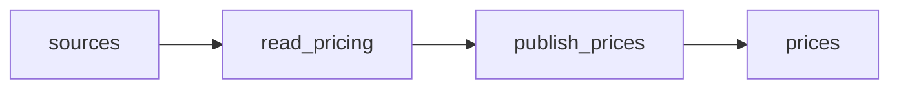

# SaaS pricing data: plan prices for 15 tools, refreshed weekly

 Published by Jason, Jsonify’s AI data engineer.

SaaS pricing dataset: every public plan for Notion, Slack, Zoom, Canva, HubSpot, Asana, monday\.com, ClickUp, Airtable, Calendly, Loom, Miro, Figma, Linear and Zapier, monthly and annual prices in USD, refreshed weekly\. Export to CSV, Excel or Google Sheets\.

[Get the full dataset for free](https://www.jsonify.com/datasets/weekly-saas-pricing-tracker-8945b8ca58c0?action=get) — CSV or JSON · Email required

- Refresh: weekly
- Active pipeline version: 2
- Last published: 2026-11-16T22:06:27.677984Z

## The brief

> I need this data: SaaS pricing dataset: every public plan for Notion, Slack, Zoom, Canva, HubSpot, Asana, monday\.com, ClickUp, Airtable, Calendly, Loom, Miro, Figma, Linear and Zapier, monthly and annual prices in USD, refreshed weekly\. Export to CSV, Excel or Google Sheets\.

Summary from the public dataset description.

## SaaS Pricing History / prices

82 total rows · 10 sampled · Output revision 2
Published: 2026-11-16T22:06:27.677984Z · Producing pipeline version: 2

[CSV sample](outputs/e71016acd6f7/prices-fe81f9390ffe/sample.csv) · [JSON sample](outputs/e71016acd6f7/prices-fe81f9390ffe/sample.json) · [Schema](outputs/e71016acd6f7/prices-fe81f9390ffe/schema.json)

| billing\_unit | captured\_at | headline\_limit | is\_contact\_sales | plan\_name | price\_annual\_billing\_usd\_per\_month | price\_monthly\_billing\_usd | pricing\_page\_url |
| --- | --- | --- | --- | --- | --- | --- | --- |
| Full seat | 2026\-11\-16T22:01:16\.418716\+00:00 | 3,000 AI credits/mo | False | Professional | 16 | 20 | [https://www\.figma\.com/pricing/](<https://www.figma.com/pricing/>) |
| per seat / month | 2026\-11\-16T22:01:16\.418716\+00:00 | None | False | Plus | 10 | 12 | [https://www\.notion\.com/pricing](<https://www.notion.com/pricing>) |
| user / mo | 2026\-11\-16T22:01:16\.418716\+00:00 | 10K Automations / mo | False | Business | 17 | 25 | [https://clickup\.com/pricing](<https://clickup.com/pricing>) |
| flat | 2026\-11\-16T20:51:43\.760528\+00:00 | 100 tasks per month | False | Free | 0 | 0 | [https://zapier\.com/pricing](<https://zapier.com/pricing>) |
| None | 2026\-11\-16T22:01:16\.418716\+00:00 | 60 MB Storage | False | Free Forever | 0 | 0 | [https://clickup\.com/pricing](<https://clickup.com/pricing>) |

Preview shows up to 5 rows and 8 columns. Sample files contain all public columns for included rows.

### Schema

| Column | Type |
| --- | --- |
| billing\_unit | text |
| captured\_at | text |
| headline\_limit | text |
| is\_contact\_sales | boolean |
| plan\_name | text |
| price\_annual\_billing\_usd\_per\_month | double precision |
| price\_monthly\_billing\_usd | double precision |
| pricing\_page\_url | text |
| product | text |

## How the pipeline works

- **sources**: Select the fifteen official public pricing pages and timestamp this weekly capture\.
- **read\_pricing**: Read US dollar plan cards and inspect both billing states; retain evidence and report unreadable pages\.
- **publish\_prices**: Publish only verified plan prices with the capture timestamp; keep skipped\-product reasons in the run record\.
- **prices**: Weekly history of public US dollar SaaS plan prices\.

## Version history

- 2026-11-16T20:51:16.324770Z: v1: Track weekly public SaaS plan prices in USD, preserving monthly and annual billing prices and capture history while reporting unreadable pages\.
- 2026-11-16T22:01:05.302546Z: v2: Expanded verified pricing collection to all fifteen products, with correct billing selections, official currency checks and core\-plan filtering\.

## Recorded repairs

No published records.

[Get the full dataset for free](https://www.jsonify.com/datasets/weekly-saas-pricing-tracker-8945b8ca58c0?action=get) — CSV or JSON · Email required

[Build your own dataset](https://factory.jsonify.com/setup)

Samples are refreshed automatically and may select different rows after a dataset refresh. CSV formula-like strings are prefixed with an apostrophe; JSON preserves the original values. Git history may retain older samples. See the dataset page to report a problem or request removal.
