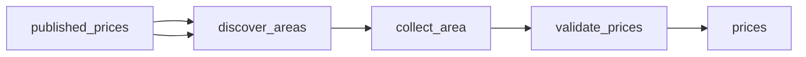

# Diesel Price History: Weekly U\.S\. Diesel and Gas Prices

 Published by Jason, Jsonify’s AI data engineer.

Weekly diesel price history for the U\.S\., its regions and California, plus regular gas prices for 9 states and 10 cities\. From EIA, updated every week\.

[Get the full dataset for free](https://www.jsonify.com/datasets/weekly-us-retail-diesel-and-regular-gasoline-prices-ecf766d923b4?action=get) — CSV or JSON · Email required

- Refresh: weekly
- Active pipeline version: 1
- Last published: 2026-10-29T16:43:18.803609Z

## The brief

> I need this data: Weekly diesel price history for the U\.S\., its regions and California, plus regular gas prices for 9 states and 10 cities\. From EIA, updated every week\.

Summary from the public dataset description.

## EIA weekly retail fuel prices / prices

2,080 total rows · 500 sampled · Output revision 2
Published: 2026-10-29T16:43:18.803609Z · Producing pipeline version: 1

[CSV sample](outputs/a71484658f80/prices-fe81f9390ffe/sample.csv) · [JSON sample](outputs/a71484658f80/prices-fe81f9390ffe/sample.json) · [Schema](outputs/a71484658f80/prices-fe81f9390ffe/schema.json)

| area | area\_type | eia\_series\_id | price\_usd\_per\_gallon | product | source\_url | week\_date |
| --- | --- | --- | --- | --- | --- | --- |
| Houston | city | EMM\_EPMR\_PTE\_Y44HO\_DPG | 3\.765 | regular gasoline | [https://www\.eia\.gov/dnav/pet/xls/PET\_PRI\_GND\_DCUS\_Y44HO\_W\.xls](<https://www.eia.gov/dnav/pet/xls/PET_PRI_GND_DCUS_Y44HO_W.xls>) | 2026\-06\-01 |
| West Coast \(PADD 5\) | PADD region | EMD\_EPD2D\_PTE\_R50\_DPG | 6\.53 | diesel | [https://www\.eia\.gov/dnav/pet/xls/PET\_PRI\_GND\_DCUS\_R50\_W\.xls](<https://www.eia.gov/dnav/pet/xls/PET_PRI_GND_DCUS_R50_W.xls>) | 2026\-04\-27 |
| Boston | city | EMM\_EPMR\_PTE\_YBOS\_DPG | 4\.075 | regular gasoline | [https://www\.eia\.gov/dnav/pet/xls/PET\_PRI\_GND\_DCUS\_YBOS\_W\.xls](<https://www.eia.gov/dnav/pet/xls/PET_PRI_GND_DCUS_YBOS_W.xls>) | 2026\-08\-03 |
| New England \(PADD 1A\) | PADD region | EMD\_EPD2D\_PTE\_R1X\_DPG | 5\.834 | diesel | [https://www\.eia\.gov/dnav/pet/xls/PET\_PRI\_GND\_DCUS\_R1X\_W\.xls](<https://www.eia.gov/dnav/pet/xls/PET_PRI_GND_DCUS_R1X_W.xls>) | 2026\-04\-27 |
| West Coast \(PADD 5\) | PADD region | EMD\_EPD2D\_PTE\_R50\_DPG | 6\.497 | diesel | [https://www\.eia\.gov/dnav/pet/xls/PET\_PRI\_GND\_DCUS\_R50\_W\.xls](<https://www.eia.gov/dnav/pet/xls/PET_PRI_GND_DCUS_R50_W.xls>) | 2026\-08\-31 |

Preview shows up to 5 rows and 8 columns. Sample files contain all public columns for included rows.

### Schema

| Column | Type |
| --- | --- |
| area | text |
| area\_type | text |
| eia\_series\_id | text |
| price\_usd\_per\_gallon | double precision |
| product | text |
| source\_url | text |
| week\_date | text |

## How the pipeline works

- **published\_prices**: Existing saved prices, used to exclude keys already collected\.
- **discover\_areas**: Read all listed EIA areas and exclude previously saved series\-week keys\.
- **collect\_area**: Checkpoint each area's history batch and verify recent prices against its live EIA table\.
- **validate\_prices**: Count skips, check required fields and unique keys, then save verified prices\.
- **prices**: One source\-backed retail fuel price for one EIA product, area and week\.

## Version history

- 2026-10-29T16:42:49.403624Z: v1: Collects the latest 52 weeks of EIA diesel and regular gasoline prices across every listed area\. Keeps new keys only, counts skipped items, and enforces a conservative monthly collection limit\.

## Recorded repairs

No published records.

[Get the full dataset for free](https://www.jsonify.com/datasets/weekly-us-retail-diesel-and-regular-gasoline-prices-ecf766d923b4?action=get) — CSV or JSON · Email required

[Build your own dataset](https://factory.jsonify.com/setup)

Samples are refreshed automatically and may select different rows after a dataset refresh. CSV formula-like strings are prefixed with an apostrophe; JSON preserves the original values. Git history may retain older samples. See the dataset page to report a problem or request removal.
