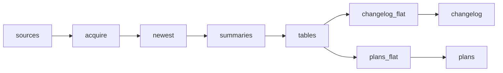

# Workflow automation pricing &amp; changelog

 Published by Jason, Jsonify’s AI data engineer.

[Get the full dataset for free](https://www.jsonify.com/datasets/workflow-automation-pricing-changelog-43016ab54052?action=get) — CSV or JSON · Email required

- Refresh: On demand
- Active pipeline version: 6
- Last published: 2026-10-14T12:36:28.908129Z

## Workflow automation pricing &amp; changelog / plans

24 total rows · 24 sampled · Output revision 3
Published: 2026-10-14T12:36:28.908129Z · Producing pipeline version: 6

[CSV sample](outputs/d5f50b0a8f2c/plans-c404dc69b55c/sample.csv) · [JSON sample](outputs/d5f50b0a8f2c/plans-c404dc69b55c/sample.json) · [Schema](outputs/d5f50b0a8f2c/plans-c404dc69b55c/schema.json)

| billing\_unit | checked | currency | included\_units | plan | price\_annual\_monthly | price\_monthly | price\_note |
| --- | --- | --- | --- | --- | --- | --- | --- |
| credits | 2026\-10\-14 | USD | 1000 | Free | 0 | 0 |  |
| tasks | 2026\-10\-14 | USD | None | Enterprise | None | None | Contact sales |
| executions | 2026\-10\-14 | EUR | 40000 | Business | 667 | 800 |  |
| credits | 2026\-10\-14 | USD | None | Ultimate | None | None | Contact sales |
| tasks | 2026\-10\-14 | USD | 100 | Free | 0 | 0 |  |

Preview shows up to 5 rows and 8 columns. Sample files contain all public columns for included rows.

### Schema

| Column | Type |
| --- | --- |
| billing\_unit | text |
| checked | text |
| currency | text |
| included\_units | double precision |
| plan | text |
| price\_annual\_monthly | double precision |
| price\_monthly | double precision |
| price\_note | text |
| source\_url | text |
| tool | text |

## Workflow automation pricing &amp; changelog / changelog

40 total rows · 40 sampled · Output revision 3
Published: 2026-10-14T12:36:28.908129Z · Producing pipeline version: 6

[CSV sample](outputs/d5f50b0a8f2c/changelog-6665bc2f57c4/sample.csv) · [JSON sample](outputs/d5f50b0a8f2c/changelog-6665bc2f57c4/sample.json) · [Schema](outputs/d5f50b0a8f2c/changelog-6665bc2f57c4/schema.json)

| checked | date | summary | title | tool | url |
| --- | --- | --- | --- | --- | --- |
| 2026\-10\-14 | 2025\-06\-13 | Pipedream released a developer playground for Connect that demonstrates the server API/SDK and the connect\-react package\. Updates include a Debug tab showing calls, payloads, and responses in real tim | New Developer Playground for Pipedream Connect | Pipedream | [https://pipedream\.com/docs/changelog\#new\-developer\-playground\-for\-pipedream\-connect](<https://pipedream.com/docs/changelog#new-developer-playground-for-pipedream-connect>) |
| 2026\-10\-14 | 2026\-09\-25 | The September 25, 2026 update covers an Alegra resource ID format change now in effect, support for Claude Opus 5\.5 and Gemini Omni 1\.1 Flash, an upcoming Gemini deprecation, and other app updates\. | Alegra resource ID format change, Google Gemini AI model, and more app updates | Make | [https://help\.make\.com/alegra\-resource\-id\-format\-change\-google\-gemini\-ai\-model\-and\-more\-app\-updates](<https://help.make.com/alegra-resource-id-format-change-google-gemini-ai-model-and-more-app-updates>) |
| 2026\-10\-14 | 2026\-07\-08 | ZapConnect is a free, one\-day virtual event on September 23 at 9 AM PT / 12 PM ET, featuring 30\+ sessions and 50 speakers on AI automation, including keynotes, live build\-alongs, governance playbooks, | ZapConnect 2026 registration is open 🎉 | Zapier | [https://community\.zapier\.com/product\-updates/zapconnect\-2026\-registration\-is\-open\-53579](<https://community.zapier.com/product-updates/zapconnect-2026-registration-is-open-53579>) |
| 2026\-10\-14 | 2026\-09\-21 | Version 0\.91\.1 includes fixes for subflow retries and connection references\. The build fix moves MinIO off Docker Hub and removes source maps that the image build deletes\. | 0\.91\.1 | Activepieces | [https://github\.com/activepieces/activepieces/releases/tag/0\.91\.1](<https://github.com/activepieces/activepieces/releases/tag/0.91.1>) |
| 2026\-10\-14 | 2026\-09\-01 | n8n 2\.38\.1 was released on 2026\-09\-01\. Its MongoDB node batches writes with bulkWrite, and the release includes nine other features\. | n8n@2\.38\.1 | n8n | [https://docs\.n8n\.io/release\-notes/\#n8n2381](<https://docs.n8n.io/release-notes/#n8n2381>) |

Preview shows up to 5 rows and 8 columns. Sample files contain all public columns for included rows.

### Schema

| Column | Type |
| --- | --- |
| checked | text |
| date | text |
| summary | text |
| title | text |
| tool | text |
| url | text |

## How the pipeline works

- **sources**: Prepare the five specified public pricing pages and five changelog sources\.
- **acquire**: Read public plan cards in both billing modes and dated release entries; Make pricing uses a browser\.
- **newest**: Deduplicate updates by tool and deep link, retain all plans, and keep newest updates within the combined row cap\.
- **summaries**: Summarize only the dated source entry in one or two plain sentences and stamp the run's UTC date\.
- **tables**: Separate the plan snapshot and dated changelog entries into two flat tables\.
- **plans\_flat**: Publish exactly the requested ten scalar plan fields, with explicit nulls for unpublished prices\.
- **plans**: sink
- **changelog\_flat**: Publish exactly the six requested scalar changelog fields without wrappers or nested JSON\.
- **changelog**: sink

## Version history

- 2026-10-14T09:39:04.492554Z: v1: Added public plan pricing and dated changelog tables for five automation tools, using flat JSON rows and explicit notes for unavailable USD prices\. No schedule is enabled\.
- 2026-10-14T09:47:59.105880Z: v2: Keep displayed prices in EUR for n8n and USD for other vendors, with renamed price columns and a currency field\. Retain each tool’s newest five changelog entries when fewer than five meet the cutoff\.
- 2026-10-14T10:04:29.676158Z: v3: Collect n8n pricing from its EUR region and verify the currency in each billing snapshot\. Other sources and both output tables are unchanged\.
- 2026-10-14T10:25:52.368516Z: v4: n8n now keeps the USD or EUR currency shown alongside each plan price, without requiring EUR or converting amounts\. Also fixed Activepieces billing\-toggle readiness after the page redraws\.
- 2026-10-14T10:45:35.302686Z: v5: Community Edition now receives zero monthly and annual\-monthly prices with “Free, self\-hosted” only when the pricing page explicitly states this\. Billing selection is more reliable, and both outputs are connected to the dataset prepared for read\-only API access\.
- 2026-10-14T12:11:05.836423Z: v6: Make and Zapier prices now use explicit USD, starting\-tier and billing settings and read the rendered price cards\. Activepieces Embed retains its annual starting minimum, and changelogs keep the newest 5–10 entries per tool\.

## Recorded repairs

No published records.

[Get the full dataset for free](https://www.jsonify.com/datasets/workflow-automation-pricing-changelog-43016ab54052?action=get) — CSV or JSON · Email required

[Build your own dataset](https://factory.jsonify.com/setup)

Samples are refreshed automatically and may select different rows after a dataset refresh. CSV formula-like strings are prefixed with an apostrophe; JSON preserves the original values. Git history may retain older samples. See the dataset page to report a problem or request removal.
