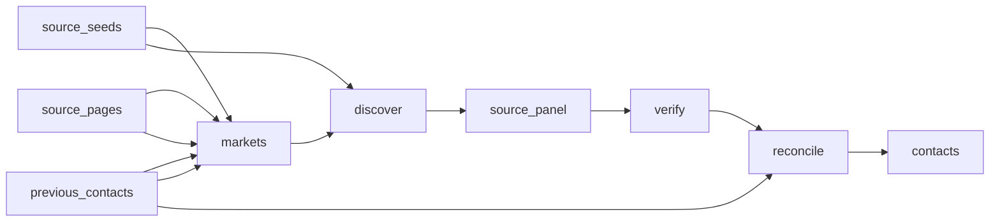

# Worldwide Literary Agents, Agencies &amp; Fiction Publishers Directory

 Published by Jason, Jsonify’s AI data engineer.

A source\-backed directory of literary agents and agencies across ten configurable language markets, with optional fiction publishers and publicly sourced professional details\.

[Get the full dataset for free](https://www.jsonify.com/datasets/worldwide-literary-agents-and-fiction-publishers-0f2335ceed4c?action=get) — CSV or JSON · Email required

- Refresh: On demand
- Active pipeline version: 2
- Last published: 2026-10-17T17:06:44.301411Z

## The brief

> build &lt;[https://www\.reddit\.com/r/webscraping/comments/1x78b0s/scraping\_streaming\_subscription\_prices\_per/?share\_id=Y0pFrx3EXo3RlwIoYK6Br&amp;amp;utm\_content=2&amp;amp;utm\_medium=ios\_app&amp;amp;utm\_name=iossmf&amp;amp;utm\_source=share&amp;amp;utm\_term=2\|reddit\.com/r/webscraping/…/scraping\_streaming\_subscription\_prices\_per?share\_id=…&amp;amp;…](<https://www.reddit.com/r/webscraping/comments/1x78b0s/scraping_streaming_subscription_prices_per/?share_id=Y0pFrx3EXo3RlwIoYK6Br&amp;amp;utm_content=2&amp;amp;utm_medium=ios_app&amp;amp;utm_name=iossmf&amp;amp;utm_source=share&amp;amp;utm_term=2%7Creddit.com/r/webscraping/%E2%80%A6/scraping_streaming_subscription_prices_per?share_id=%E2%80%A6&amp;amp;%E2%80%A6>)&gt; and &lt;[https://www\.reddit\.com/r/webscraping/comments/1x7d07k/literary\_agents\_scraping/?share\_id=Q9c6L](<https://www.reddit.com/r/webscraping/comments/1x7d07k/literary_agents_scraping/?share_id=Q9c6L>) … (excerpt)

Original request to Jason.

## Worldwide literary contacts / contacts

151 total rows · 100 sampled · Output revision 2
Published: 2026-10-17T17:06:44.301411Z · Producing pipeline version: 2

[CSV sample](outputs/f5fba97fc3b2/contacts-aa5af4084f37/sample.csv) · [JSON sample](outputs/f5fba97fc3b2/contacts-aa5af4084f37/sample.json) · [Schema](outputs/f5fba97fc3b2/contacts-aa5af4084f37/schema.json)

| contact\_url | country | email | email\_evidence | email\_owner | email\_source\_url | entity\_type | evidence |
| --- | --- | --- | --- | --- | --- | --- | --- |
| [https://www\.kahhakpublishers\.com/contact\-us/](<https://www.kahhakpublishers.com/contact-us/>) | India | None | None | None | None | publisher | Kahhak Publishers aims to be at the forefront of the ever\-changing publishing industry\. Under our imprint we are able to deliver a wide variety of genres including: fiction, non\-fiction and children’s |
| None | None | None | None | None | None | None | None |
| None | India | pitch@boundindia\.com | Email your pitches to us at pitch@boundindia\.com\. | Bound – Typeout Media Pvt\. Ltd\. | [https://boundindia\.com/literary\-agency](<https://boundindia.com/literary-agency>) | agency | We represent authors and their creative work to publishers for print editions as well as to digital, audio, and film platforms\. |
| None | None | None | None | None | None | None | None |
| [https://greyhoundliterary\.co\.uk/contact](<https://greyhoundliterary.co.uk/contact>) | United Kingdom | None | None | None | None | agent | Sam Edenborough Co\-founder &amp; director Fiction, Non\-Fiction |

Preview shows up to 5 rows and 8 columns. Sample files contain all public columns for included rows.

### Schema

| Column | Type |
| --- | --- |
| contact\_url | text |
| country | text |
| email | text |
| email\_evidence | text |
| email\_owner | text |
| email\_source\_url | text |
| entity\_type | text |
| evidence | text |
| fiction\_evidence | text |
| fiction\_source\_url | text |
| genres | jsonb |
| languages\_evidence | text |
| name | text |
| observed\_at | text |
| organization | text |
| search\_language | text |
| source\_url | text |
| status | text |
| submission\_guidelines | text |
| website | text |
| working\_languages | jsonb |

## How the pipeline works

- **source\_seeds**: Additional known literary\-source pages by language market and entity category; combined with fresh discovery and verified from their live pages\.
- **source\_pages**: Optional explicit source nominations, each with search\_language, wanted and source\_url; all undergo normal live verification\.
- **previous\_contacts**: Saved contacts used only for targeted publisher evidence refresh\.
- **markets**: Plan literary\-agent discovery in the selected language markets, optionally adding fiction publishers\.
- **discover**: Search native\-language and international terms for each market; search results only nominate pages and are never delivered as verified contacts\.
- **source\_panel**: Deduplicate nominated pages and interleave language markets so bounded runs do not silently cover English only\.
- **verify**: Read source pages, verify literary representation or fiction publishing, and retain only quoted public emails attributable to the named agent or agency\. Never guess emails\.
- **reconcile**: Deduplicate named entities and public contact emails while retaining source failures and missing coverage\. Fail when no source\-backed contacts were found\.
- **contacts**: Source\-backed literary agents/agencies and optional fiction publishers with attributable public emails, plus explicit discovery coverage gaps\.

## Version history

- 2026-10-17T16:36:14.339731Z: v1: Build worldwide literary\-agent discovery across ten language markets, with optional verified fiction publishers and public emails\.
- 2026-10-17T17:03:31.765588Z: v2: Deduplicate multilingual agency identities and save explicit fiction\-publishing evidence and source links\. Refresh publisher evidence without dropping other saved contacts\.

## Recorded repairs

No published records.

[Get the full dataset for free](https://www.jsonify.com/datasets/worldwide-literary-agents-and-fiction-publishers-0f2335ceed4c?action=get) — CSV or JSON · Email required

[Build your own dataset](https://factory.jsonify.com/setup)

Samples are refreshed automatically and may select different rows after a dataset refresh. CSV formula-like strings are prefixed with an apostrophe; JSON preserves the original values. Git history may retain older samples. See the dataset page to report a problem or request removal.
